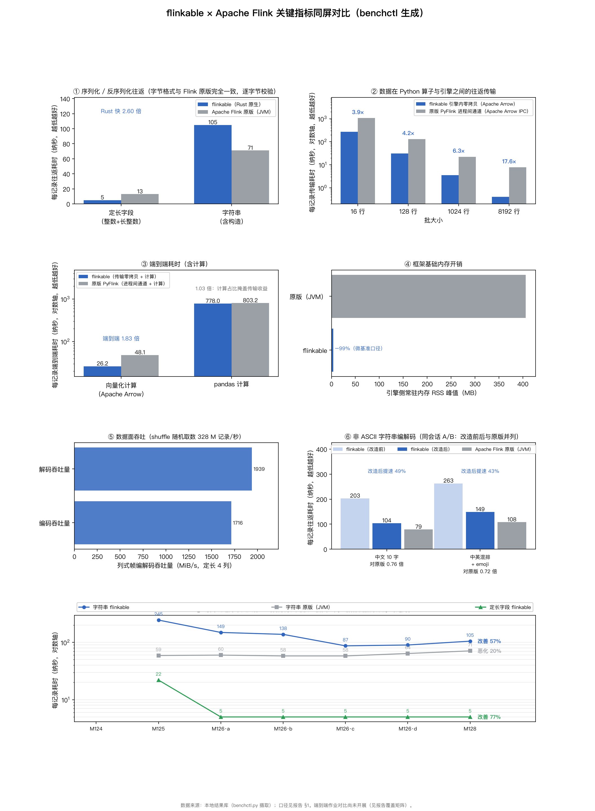

# flinkable × Apache Flink 关键指标同屏对比（benchctl 生成）

环境：bench rig（x86_64 4 核 Linux、数据盘、release 构建），锚栈 CPython 3.11.17 + pyarrow 14.0.2 + beam 2.54.0 + pemja 0.5.7，JDK 17
口径：微基准单机；柱形取各用例最近一次值；“改造前/改造后”与“对原版”倍数取自同一次运行内的并列腿

## 指标明细（每项取最近一次摄取值）

| 指标 | 度量 | 数值 | 方向 |
| --- | --- | --- | --- |
| 序列化往返：定长字段（整数+长整数） | Apache Flink 原版（JVM） | 13 纳秒/记录 | 越低越好 |
| 序列化往返：定长字段（整数+长整数） | 原版/flinkable 耗时比 | 2.6 倍 | 越高越好 |
| 序列化往返：定长字段（整数+长整数） | flinkable（Rust 原生） | 5 纳秒/记录 | 越低越好 |
| 序列化往返：字符串（含构造） | Apache Flink 原版（JVM） | 71 纳秒/记录 | 越低越好 |
| 序列化往返：字符串（含构造） | 原版/flinkable 耗时比 | 0.68 倍 | 越高越好 |
| 序列化往返：字符串（含构造） | flinkable（Rust 原生） | 105 纳秒/记录 | 越低越好 |
| 算子间数据传输（批大小 16 行） | 原版 PyFlink 进程间通道（Apache Arrow IPC） | 1062 纳秒/记录 | 越低越好 |
| 算子间数据传输（批大小 16 行） | flinkable 引擎内零拷贝 | 270.2 纳秒/记录 | 越低越好 |
| 算子间数据传输（批大小 16 行） | 传输耗时比（原版/flinkable） | 3.93 倍 | 越高越好 |
| 算子间数据传输（批大小 128 行） | 原版 PyFlink 进程间通道（Apache Arrow IPC） | 130.1 纳秒/记录 | 越低越好 |
| 算子间数据传输（批大小 128 行） | flinkable 引擎内零拷贝 | 30.9 纳秒/记录 | 越低越好 |
| 算子间数据传输（批大小 128 行） | 传输耗时比（原版/flinkable） | 4.21 倍 | 越高越好 |
| 算子间数据传输（批大小 1024 行） | 原版 PyFlink 进程间通道（Apache Arrow IPC） | 22.3 纳秒/记录 | 越低越好 |
| 算子间数据传输（批大小 1024 行） | flinkable 引擎内零拷贝 | 3.5 纳秒/记录 | 越低越好 |
| 算子间数据传输（批大小 1024 行） | 传输耗时比（原版/flinkable） | 6.35 倍 | 越高越好 |
| 算子间数据传输（批大小 8192 行） | 原版 PyFlink 进程间通道（Apache Arrow IPC） | 7.7 纳秒/记录 | 越低越好 |
| 算子间数据传输（批大小 8192 行） | flinkable 引擎内零拷贝 | 0.4 纳秒/记录 | 越低越好 |
| 算子间数据传输（批大小 8192 行） | 传输耗时比（原版/flinkable） | 17.65 倍 | 越高越好 |
| 端到端耗时（向量化计算，Apache Arrow） | 端到端耗时比（原版/flinkable） | 1.83 倍 | 越高越好 |
| 端到端耗时（向量化计算，Apache Arrow） | 原版 PyFlink 端到端 | 48.1 纳秒/记录 | 越低越好 |
| 端到端耗时（向量化计算，Apache Arrow） | flinkable 端到端 | 26.2 纳秒/记录 | 越低越好 |
| 端到端耗时（pandas 计算） | 端到端耗时比（原版/flinkable） | 1.03 倍 | 越高越好 |
| 端到端耗时（pandas 计算） | 原版 PyFlink 端到端 | 803.2 纳秒/记录 | 越低越好 |
| 端到端耗时（pandas 计算） | flinkable 端到端 | 778 纳秒/记录 | 越低越好 |
| 引擎侧常驻内存 RSS | Apache Flink 原版（JVM） | 406 MB | 越低越好 |
| 引擎侧常驻内存 RSS | flinkable（Rust 原生） | 4 MB | 越低越好 |
| 列式帧编码（Apache Arrow） | 每记录耗时 | 18.42 纳秒/记录 | 越低越好 |
| 列式帧编码（Apache Arrow） | 吞吐量 | 1716 MiB/s | 越高越好 |
| 列式帧解码（Apache Arrow） | 每字段耗时 | 4.075 纳秒/字段 | 越低越好 |
| 列式帧解码（Apache Arrow） | 每记录耗时 | 16.3 纳秒/记录 | 越低越好 |
| 列式帧解码（Apache Arrow） | 吞吐量 | 1939 MiB/s | 越高越好 |
| 线上字节量 | 每记录线上字节 | 33.14 字节/记录 | 越低越好 |
| shuffle 随机取数 | 每字段耗时 | 0.762 纳秒/字段 | 越低越好 |
| shuffle 随机取数 | 每记录耗时 | 3.05 纳秒/记录 | 越低越好 |
| shuffle 随机取数 | 吞吐量 | 328.1 百万记录/秒 | 越高越好 |
| 算子间数据传输（批接口） | 仅导出 | 0.6 纳秒/记录 | 越低越好 |
| 算子间数据传输（批接口） | 导出吞吐量 | 5.124e+04 MiB/s | 越高越好 |
| 算子间数据传输（批接口） | 原版 PyFlink 进程间通道（Apache Arrow IPC） | 26.3 纳秒/记录 | 越低越好 |
| 算子间数据传输（批接口） | 进程间通道吞吐量 | 1186 MiB/s | 越高越好 |
| 算子间数据传输（批接口） | 零拷贝吞吐量 | 1.807e+04 MiB/s | 越高越好 |
| 算子间数据传输（批接口） | flinkable 引擎内零拷贝 | 1.7 纳秒/记录 | 越低越好 |
| 算子间数据传输（批接口） | 传输耗时比（原版/flinkable） | 15.24 倍 | 越高越好 |
| 解码通道：ASCII 12 字节 | flinkable（Rust 原生） | 35 纳秒/记录 | 越低越好 |
| 解码通道：ASCII 12 字节 | flinkable（改造前） | 32 纳秒/记录 | 越低越好 |
| 解码通道：ASCII 12 字节 | flinkable（借用零分配） | 22 纳秒/记录 | 越低越好 |
| 解码通道：ASCII 47 字节 | flinkable（Rust 原生） | 37 纳秒/记录 | 越低越好 |
| 解码通道：ASCII 47 字节 | flinkable（改造前） | 46 纳秒/记录 | 越低越好 |
| 解码通道：ASCII 47 字节 | flinkable（借用零分配） | 24 纳秒/记录 | 越低越好 |
| 解码通道：中文 52 字 | flinkable（Rust 原生） | 236 纳秒/记录 | 越低越好 |
| 解码通道：中文 52 字 | flinkable（改造前） | 392 纳秒/记录 | 越低越好 |
| 解码通道：中文 52 字 | flinkable（借用零分配） | 239 纳秒/记录 | 越低越好 |
| 解码通道：中文 10 字 | flinkable（Rust 原生） | 61 纳秒/记录 | 越低越好 |
| 解码通道：中文 10 字 | flinkable（改造前） | 131 纳秒/记录 | 越低越好 |
| 解码通道：中文 10 字 | flinkable（借用零分配） | 64 纳秒/记录 | 越低越好 |
| 解码通道：emoji | flinkable（Rust 原生） | 41 纳秒/记录 | 越低越好 |
| 解码通道：emoji | flinkable（改造前） | 55 纳秒/记录 | 越低越好 |
| 解码通道：emoji | flinkable（借用零分配） | 45 纳秒/记录 | 越低越好 |
| 解码通道：日文 16 字 | flinkable（Rust 原生） | 74 纳秒/记录 | 越低越好 |
| 解码通道：日文 16 字 | flinkable（改造前） | 171 纳秒/记录 | 越低越好 |
| 解码通道：日文 16 字 | flinkable（借用零分配） | 78 纳秒/记录 | 越低越好 |
| 解码通道：中英混排 + emoji | flinkable（Rust 原生） | 81 纳秒/记录 | 越低越好 |
| 解码通道：中英混排 + emoji | flinkable（改造前） | 173 纳秒/记录 | 越低越好 |
| 解码通道：中英混排 + emoji | flinkable（借用零分配） | 87 纳秒/记录 | 越低越好 |
| 编码通道：ASCII 12 字节 | flinkable（Rust 原生） | 8 纳秒/记录 | 越低越好 |
| 编码通道：ASCII 12 字节 | flinkable（改造前） | 7 纳秒/记录 | 越低越好 |
| 编码通道：ASCII 47 字节 | flinkable（Rust 原生） | 9 纳秒/记录 | 越低越好 |
| 编码通道：ASCII 47 字节 | flinkable（改造前） | 9 纳秒/记录 | 越低越好 |
| 编码通道：中文 52 字 | flinkable（Rust 原生） | 196 纳秒/记录 | 越低越好 |
| 编码通道：中文 52 字 | flinkable（改造前） | 363 纳秒/记录 | 越低越好 |
| 编码通道：中文 10 字 | flinkable（Rust 原生） | 43 纳秒/记录 | 越低越好 |
| 编码通道：中文 10 字 | flinkable（改造前） | 72 纳秒/记录 | 越低越好 |
| 编码通道：emoji | flinkable（Rust 原生） | 25 纳秒/记录 | 越低越好 |
| 编码通道：emoji | flinkable（改造前） | 37 纳秒/记录 | 越低越好 |
| 编码通道：日文 16 字 | flinkable（Rust 原生） | 66 纳秒/记录 | 越低越好 |
| 编码通道：日文 16 字 | flinkable（改造前） | 104 纳秒/记录 | 越低越好 |
| 编码通道：中英混排 + emoji | flinkable（Rust 原生） | 68 纳秒/记录 | 越低越好 |
| 编码通道：中英混排 + emoji | flinkable（改造前） | 90 纳秒/记录 | 越低越好 |
| 序列化往返：中文 10 字（非 ASCII） | Apache Flink 原版（JVM） | 79 纳秒/记录 | 越低越好 |
| 序列化往返：中文 10 字（非 ASCII） | 原版/flinkable 耗时比 | 0.69 倍 | 越高越好 |
| 序列化往返：中文 10 字（非 ASCII） | flinkable（Rust 原生） | 114 纳秒/记录 | 越低越好 |
| 序列化往返：中文 40 字（非 ASCII） | Apache Flink 原版（JVM） | 208 纳秒/记录 | 越低越好 |
| 序列化往返：中文 40 字（非 ASCII） | 原版/flinkable 耗时比 | 0.67 倍 | 越高越好 |
| 序列化往返：中文 40 字（非 ASCII） | flinkable（Rust 原生） | 312 纳秒/记录 | 越低越好 |
| 序列化往返：中英混排 + emoji | Apache Flink 原版（JVM） | 108 纳秒/记录 | 越低越好 |
| 序列化往返：中英混排 + emoji | 原版/flinkable 耗时比 | 0.67 倍 | 越高越好 |
| 序列化往返：中英混排 + emoji | flinkable（Rust 原生） | 162 纳秒/记录 | 越低越好 |

## 非 ASCII 字符串编解码（同会话 A/B，改造前后与原版并列）

| 形状 | 改造前 | 改造后 | 提速 | 原版（JVM） | 改造后/原版 |
| --- | --- | --- | --- | --- | --- |
| 中文 10 字 | 203 | 104 | 49% | 79 纳秒/记录 | 0.76 倍 |
| 中文 52 字 | 755 | 432 | 43% | 未对表 | — |
| 日文 16 字 | 275 | 140 | 49% | 未对表 | — |
| emoji | 92 | 66 | 28% | 未对表 | — |
| 中英混排 + emoji | 263 | 149 | 43% | 108 纳秒/记录 | 0.72 倍 |
| ASCII 12 字节（对照） | 39 | 43 | -10% | 未对表 | — |

口径：编解码往返耗时（纳秒/记录），不含值构造项；“改造前/改造后”取自同一次运行内的 A/B 腿，避免跨会话机器状态漂移；“原版”为 Flink `StringSerializer` 经 `DataOutputSerializer`/`DataInputDeserializer` 的完整往返（另含一次缓冲拷贝分配）。emoji 与日文行暂无原版对表值。

## 时间线趋势（同一指标随摄取次序，Codespeed 式核心视图）

| 指标 | 度量 | M124 | M125 | M126·a | M126·b | M126·c | M126·d | M128 |
| --- | --- | --- | --- | --- | --- | --- | --- | --- |
| 序列化往返：字符串（含构造） | flinkable（Rust 原生） | — | 245 | 149 | 138 | 87 | 90 | 105 |
| 序列化往返：字符串（含构造） | Apache Flink 原版（JVM） | — | 59 | 60 | 58 | 58 | 64 | 71 |
| 序列化往返：定长字段（整数+长整数） | flinkable（Rust 原生） | — | 22 | 5 | 5 | 5 | 5 | 5 |
| 序列化往返：定长字段（整数+长整数） | Apache Flink 原版（JVM） | — | 13 | 13 | 13 | 14 | 13 | 13 |

## 回归检查（基线窗口算法，移植自上游 regression_report_v2）

| 指标 | 度量 | 状态 |
| --- | --- | --- |
| （已判定项） | — | 无回退 |

另有 86 项序列摄取次数不足 5 次，按上游方法论不参与回归判定，仅计入趋势面板。

## 术语对照

| 报告用词 | Flink 文档对应 |
| --- | --- |
| 序列化 / 反序列化 | Serialization / Deserialization |
| 每记录耗时 | per-record latency |
| 批大小 | batch size |
| 零拷贝 | zero-copy（Apache Arrow） |
| 进程间通道 | inter-process data plane（Beam worker，Arrow IPC） |
| 常驻内存（RSS） | Resident Set Size |
| 改造前 / 改造后 | before / after（同一二进制内的 A/B 腿） |
| 借用零分配 | zero-copy decode，借用输入缓冲不新建字符串 |
| 值构造项 | 基准里构造输入对象的费用，非引擎开销 |
| 同会话 | 同一台机器、同一次运行内并列测量（跨会话不可比） |
| 非 ASCII 形状 | 中文 / 日文 / emoji（UTF-16 码元多字节形制） |
| 吞吐量 | throughput |
| shuffle 随机取数 | shuffle read（Arrow take） |

