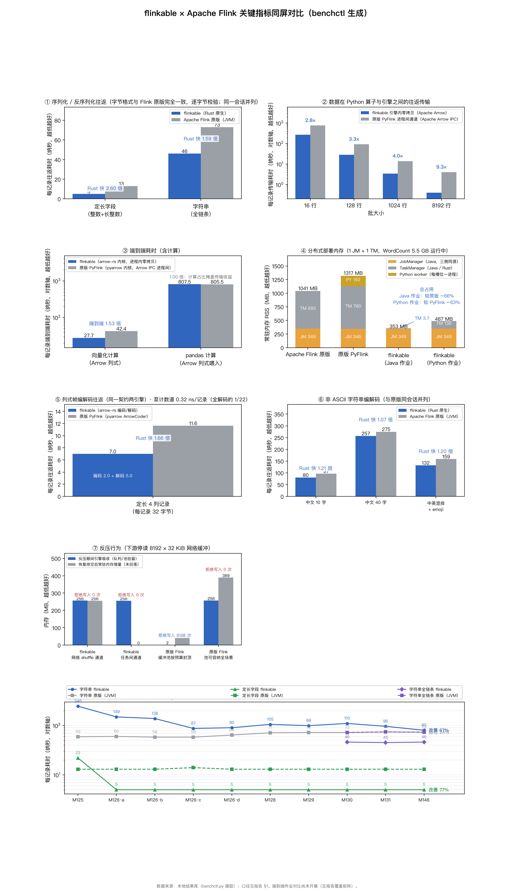

# flinkable × Apache Flink 关键指标同屏对比（benchctl 生成）

环境：x86_64 洁净台 4C/15G（118.25.82.95）；canonical 对表同会话；反压腿 8192×32 KiB（flinkable 与 Flink 2.3 缓冲池同形状）；flinkable=HEAD M146

## 指标明细（每项取最近一次摄取值）

| 指标 | 度量 | 数值 | 方向 |
| --- | --- | --- | --- |
| 序列化往返：定长字段（整数+长整数） | Apache Flink 原版（JVM） | 13 纳秒/记录 | 越低越好 |
| 序列化往返：定长字段（整数+长整数） | 原版/flinkable 耗时比 | 2.6 倍 | 越高越好 |
| 序列化往返：定长字段（整数+长整数） | flinkable（Rust 原生） | 5 纳秒/记录 | 越低越好 |
| 序列化往返：字符串（含构造） | Apache Flink 原版（JVM） | 73 纳秒/记录 | 越低越好 |
| 序列化往返：字符串（含构造） | 原版/flinkable 耗时比 | 0.91 倍 | 越高越好 |
| 序列化往返：字符串（含构造） | flinkable（Rust 原生） | 80 纳秒/记录 | 越低越好 |
| 算子间数据传输（批大小 16 行） | 原版 PyFlink 进程间通道（Apache Arrow IPC） | 754.8 纳秒/记录 | 越低越好 |
| 算子间数据传输（批大小 16 行） | flinkable 引擎内零拷贝 | 268.5 纳秒/记录 | 越低越好 |
| 算子间数据传输（批大小 16 行） | 传输耗时比（原版/flinkable） | 2.81 倍 | 越高越好 |
| 算子间数据传输（批大小 128 行） | 原版 PyFlink 进程间通道（Apache Arrow IPC） | 92 纳秒/记录 | 越低越好 |
| 算子间数据传输（批大小 128 行） | flinkable 引擎内零拷贝 | 28 纳秒/记录 | 越低越好 |
| 算子间数据传输（批大小 128 行） | 传输耗时比（原版/flinkable） | 3.29 倍 | 越高越好 |
| 算子间数据传输（批大小 1024 行） | 原版 PyFlink 进程间通道（Apache Arrow IPC） | 13.9 纳秒/记录 | 越低越好 |
| 算子间数据传输（批大小 1024 行） | flinkable 引擎内零拷贝 | 3.4 纳秒/记录 | 越低越好 |
| 算子间数据传输（批大小 1024 行） | 传输耗时比（原版/flinkable） | 4.05 倍 | 越高越好 |
| 算子间数据传输（批大小 8192 行） | 原版 PyFlink 进程间通道（Apache Arrow IPC） | 4 纳秒/记录 | 越低越好 |
| 算子间数据传输（批大小 8192 行） | flinkable 引擎内零拷贝 | 0.4 纳秒/记录 | 越低越好 |
| 算子间数据传输（批大小 8192 行） | 传输耗时比（原版/flinkable） | 9.27 倍 | 越高越好 |
| 端到端耗时（向量化计算，Apache Arrow） | 端到端耗时比（原版/flinkable） | 1.53 倍 | 越高越好 |
| 端到端耗时（向量化计算，Apache Arrow） | 原版 PyFlink 端到端 | 42.4 纳秒/记录 | 越低越好 |
| 端到端耗时（向量化计算，Apache Arrow） | flinkable 端到端 | 27.7 纳秒/记录 | 越低越好 |
| 端到端耗时（pandas 计算） | 端到端耗时比（原版/flinkable） | 1 倍 | 越高越好 |
| 端到端耗时（pandas 计算） | 原版 PyFlink 端到端 | 805.5 纳秒/记录 | 越低越好 |
| 端到端耗时（pandas 计算） | flinkable 端到端 | 807.5 纳秒/记录 | 越低越好 |
| 引擎侧常驻内存 RSS | Apache Flink 原版（JVM） | 406 MB | 越低越好 |
| 引擎侧常驻内存 RSS | flinkable（Rust 原生） | 4 MB | 越低越好 |
| 列式帧编码（Apache Arrow） | 每记录耗时 | 13.92 纳秒/记录 | 越低越好 |
| 列式帧编码（Apache Arrow） | 吞吐量 | 2270 MiB/s | 越高越好 |
| 列式帧解码（Apache Arrow） | 每字段耗时 | 3.914 纳秒/字段 | 越低越好 |
| 列式帧解码（Apache Arrow） | 每记录耗时 | 15.66 纳秒/记录 | 越低越好 |
| 列式帧解码（Apache Arrow） | 吞吐量 | 2018 MiB/s | 越高越好 |
| 线上字节量 | 每记录线上字节 | 33.14 字节/记录 | 越低越好 |
| shuffle 随机取数 | 每字段耗时 | 0.62 纳秒/字段 | 越低越好 |
| shuffle 随机取数 | 每记录耗时 | 2.48 纳秒/记录 | 越低越好 |
| shuffle 随机取数 | 吞吐量 | 403.4 百万记录/秒 | 越高越好 |
| 算子间数据传输（批接口） | 仅导出 | 0.6 纳秒/记录 | 越低越好 |
| 算子间数据传输（批接口） | 导出吞吐量 | 5.202e+04 MiB/s | 越高越好 |
| 算子间数据传输（批接口） | 原版 PyFlink 进程间通道（Apache Arrow IPC） | 21.2 纳秒/记录 | 越低越好 |
| 算子间数据传输（批接口） | 进程间通道吞吐量 | 1476 MiB/s | 越高越好 |
| 算子间数据传输（批接口） | 零拷贝吞吐量 | 1.792e+04 MiB/s | 越高越好 |
| 算子间数据传输（批接口） | flinkable 引擎内零拷贝 | 1.7 纳秒/记录 | 越低越好 |
| 算子间数据传输（批接口） | 传输耗时比（原版/flinkable） | 12.14 倍 | 越高越好 |
| 算子融合（chaining） | 链式（未融合） | 120 纳秒/记录 | 越低越好 |
| 算子融合（chaining） | 融合后 | 72 纳秒/记录 | 越低越好 |
| 算子融合（chaining） | 加速比 | 1.67 倍 | 越高越好 |
| 网络缓冲记账 | 每记录耗时 | 72 纳秒/记录 | 越低越好 |
| 跨任务通道往返下限 | 每记录耗时 | 1.799e+04 纳秒/记录 | 越低越好 |
| 序列化往返（自有缓冲形态，历史基线）：定长字段 | flinkable（Rust 原生） | 21 纳秒/记录 | 越低越好 |
| 序列化往返（自有缓冲形态，历史基线）：字符串 | flinkable（Rust 原生） | 117 纳秒/记录 | 越低越好 |
| 解码通道：ASCII 12 字节 | flinkable（Rust 原生） | 35 纳秒/记录 | 越低越好 |
| 解码通道：ASCII 12 字节 | flinkable（改造前） | 32 纳秒/记录 | 越低越好 |
| 解码通道：ASCII 12 字节 | flinkable（借用零分配） | 22 纳秒/记录 | 越低越好 |
| 解码通道：ASCII 47 字节 | flinkable（Rust 原生） | 38 纳秒/记录 | 越低越好 |
| 解码通道：ASCII 47 字节 | flinkable（改造前） | 47 纳秒/记录 | 越低越好 |
| 解码通道：ASCII 47 字节 | flinkable（借用零分配） | 24 纳秒/记录 | 越低越好 |
| 解码通道：中文 52 字 | flinkable（Rust 原生） | 176 纳秒/记录 | 越低越好 |
| 解码通道：中文 52 字 | flinkable（改造前） | 406 纳秒/记录 | 越低越好 |
| 解码通道：中文 52 字 | flinkable（借用零分配） | 183 纳秒/记录 | 越低越好 |
| 解码通道：中文 10 字 | flinkable（Rust 原生） | 51 纳秒/记录 | 越低越好 |
| 解码通道：中文 10 字 | flinkable（改造前） | 133 纳秒/记录 | 越低越好 |
| 解码通道：中文 10 字 | flinkable（借用零分配） | 54 纳秒/记录 | 越低越好 |
| 解码通道：emoji | flinkable（Rust 原生） | 42 纳秒/记录 | 越低越好 |
| 解码通道：emoji | flinkable（改造前） | 53 纳秒/记录 | 越低越好 |
| 解码通道：emoji | flinkable（借用零分配） | 45 纳秒/记录 | 越低越好 |
| 解码通道：日文 16 字 | flinkable（Rust 原生） | 75 纳秒/记录 | 越低越好 |
| 解码通道：日文 16 字 | flinkable（改造前） | 172 纳秒/记录 | 越低越好 |
| 解码通道：日文 16 字 | flinkable（借用零分配） | 78 纳秒/记录 | 越低越好 |
| 解码通道：中英混排 + emoji | flinkable（Rust 原生） | 73 纳秒/记录 | 越低越好 |
| 解码通道：中英混排 + emoji | flinkable（改造前） | 183 纳秒/记录 | 越低越好 |
| 解码通道：中英混排 + emoji | flinkable（借用零分配） | 76 纳秒/记录 | 越低越好 |
| 编码通道：ASCII 12 字节 | flinkable（Rust 原生） | 8 纳秒/记录 | 越低越好 |
| 编码通道：ASCII 12 字节 | flinkable（改造前） | 7 纳秒/记录 | 越低越好 |
| 编码通道：ASCII 47 字节 | flinkable（Rust 原生） | 9 纳秒/记录 | 越低越好 |
| 编码通道：ASCII 47 字节 | flinkable（改造前） | 9 纳秒/记录 | 越低越好 |
| 编码通道：中文 52 字 | flinkable（Rust 原生） | 213 纳秒/记录 | 越低越好 |
| 编码通道：中文 52 字 | flinkable（改造前） | 340 纳秒/记录 | 越低越好 |
| 编码通道：中文 10 字 | flinkable（Rust 原生） | 44 纳秒/记录 | 越低越好 |
| 编码通道：中文 10 字 | flinkable（改造前） | 66 纳秒/记录 | 越低越好 |
| 编码通道：emoji | flinkable（Rust 原生） | 22 纳秒/记录 | 越低越好 |
| 编码通道：emoji | flinkable（改造前） | 36 纳秒/记录 | 越低越好 |
| 编码通道：日文 16 字 | flinkable（Rust 原生） | 76 纳秒/记录 | 越低越好 |
| 编码通道：日文 16 字 | flinkable（改造前） | 95 纳秒/记录 | 越低越好 |
| 编码通道：中英混排 + emoji | flinkable（Rust 原生） | 79 纳秒/记录 | 越低越好 |
| 编码通道：中英混排 + emoji | flinkable（改造前） | 88 纳秒/记录 | 越低越好 |
| 反压吸收（任务间通道） | 反压期间引擎吸收（队列驻留） | 256 MB | 越低越好 |
| 反压吸收（任务间通道） | 恢复排空每记录耗时 | 1646 ns/record | 越低越好 |
| 反压吸收（任务间通道） | 被拒写入次数（缓冲池背压信号） | 0 records | 越低越好 |
| 反压吸收（任务间通道） | 恢复后队列残留 | 0 MB | 越低越好 |
| 反压吸收（任务间通道） | 恢复后常驻内存未回落 | 0.5 MB | 越低越好 |
| 反压吸收（任务间通道） | 反压期间进程常驻内存增量 | 256.5 MB | 越低越好 |
| 反压吸收（网络 shuffle 通道） | 反压期间引擎吸收（队列驻留） | 256.4 MB | 越低越好 |
| 反压吸收（网络 shuffle 通道） | 恢复排空每记录耗时 | 8956 ns/buffer | 越低越好 |
| 反压吸收（网络 shuffle 通道） | 畅通时引擎内缓冲（对照） | 256.4 MB | 越低越好 |
| 反压吸收（网络 shuffle 通道） | 每缓冲写入耗时（畅通） | 1.4e+04 ns/buffer | 越低越好 |
| 反压吸收（网络 shuffle 通道） | 被拒写入次数（缓冲池背压信号） | 0 buffers | 越低越好 |
| 反压吸收（网络 shuffle 通道） | 恢复后队列残留 | 0 MB | 越低越好 |
| 反压吸收（网络 shuffle 通道） | 畅通时进程常驻内存增量（对照） | 256.8 MB | 越低越好 |
| 反压吸收（网络 shuffle 通道） | 恢复后常驻内存未回落 | 256 MB | 越低越好 |
| 反压吸收（网络 shuffle 通道） | 反压期间进程常驻内存增量 | 256.8 MB | 越低越好 |
| 反压吸收（网络 shuffle 通道） | 每缓冲写入耗时（反压中） | 1.42e+04 ns/buffer | 越低越好 |
| 反压吸收：原版（缓冲池按预算封顶） | 反压期间引擎吸收（队列驻留） | 2 MB | 越低越好 |
| 反压吸收：原版（缓冲池按预算封顶） | 恢复排空每记录耗时 | 31 ns/buffer | 越低越好 |
| 反压吸收：原版（缓冲池按预算封顶） | 每缓冲写入耗时（畅通） | 3315 ns/buffer | 越低越好 |
| 反压吸收：原版（缓冲池按预算封顶） | 被拒写入次数（缓冲池背压信号） | 8128 buffers | 越低越好 |
| 反压吸收：原版（缓冲池按预算封顶） | reservation_mb | 42.5 MB | 越低越好 |
| 反压吸收：原版（缓冲池按预算封顶） | 恢复后常驻内存未回落 | 43.9 MB | 越低越好 |
| 反压吸收：原版（缓冲池按预算封顶） | 反压期间进程常驻内存增量 | 43.7 MB | 越低越好 |
| 反压吸收：原版（缓冲池可容纳全场景） | 反压期间引擎吸收（队列驻留） | 256.5 MB | 越低越好 |
| 反压吸收：原版（缓冲池可容纳全场景） | 恢复排空每记录耗时 | 815 ns/buffer | 越低越好 |
| 反压吸收：原版（缓冲池可容纳全场景） | heap_committed_mb | 244 MB | 越低越好 |
| 反压吸收：原版（缓冲池可容纳全场景） | heap_used_mb | 132.5 MB | 越低越好 |
| 反压吸收：原版（缓冲池可容纳全场景） | 每缓冲写入耗时（畅通） | 1.156e+04 ns/buffer | 越低越好 |
| 反压吸收：原版（缓冲池可容纳全场景） | 被拒写入次数（缓冲池背压信号） | 0 buffers | 越低越好 |
| 反压吸收：原版（缓冲池可容纳全场景） | 恢复后常驻内存未回落 | 389.1 MB | 越低越好 |
| 反压吸收：原版（缓冲池可容纳全场景） | 反压期间进程常驻内存增量 | 389 MB | 越低越好 |
| shuffle 序列化往返（定长 4 列记录） | flinkable 解码段 | 5 纳秒/记录 | 越低越好 |
| shuffle 序列化往返（定长 4 列记录） | flinkable 编码段 | 2 纳秒/记录 | 越低越好 |
| shuffle 序列化往返（定长 4 列记录） | Apache Flink 原版（JVM） | 10 纳秒/记录 | 越低越好 |
| shuffle 序列化往返（定长 4 列记录） | 原版/flinkable 耗时比 | 1.43 倍 | 越高越好 |
| shuffle 序列化往返（定长 4 列记录） | flinkable（Rust 原生） | 7 纳秒/记录 | 越低越好 |
| 列式帧编解码往返（Python 算子线格式） | 原版 PyFlink（ArrowCoder，编+解） | 11.63 纳秒/记录 | 越低越好 |
| 列式帧编解码往返（Python 算子线格式） | 原版 PyFlink 解码段（ArrowCoder） | 2.15 纳秒/记录 | 越低越好 |
| 列式帧编解码往返（Python 算子线格式） | 原版 PyFlink 编码段（ArrowCoder） | 9.48 纳秒/记录 | 越低越好 |
| 分布式部署常驻内存：JobManager（Java） | Apache Flink 原版（JVM） | 349 MB | 越低越好 |
| 分布式部署常驻内存：JobManager（Java） | 原版/flinkable 耗时比 | 1 倍 | 越高越好 |
| 分布式部署常驻内存：JobManager（Java） | flink_pyflink | 345.5 MB | 越低越好 |
| 分布式部署常驻内存：JobManager（Java） | flinkable（Rust 原生） | 349 MB | 越低越好 |
| memory_py_rss | flink_pyflink | 191.9 MB | 越低越好 |
| 分布式部署常驻内存：TaskManager | Apache Flink 原版（JVM） | 692 MB | 越低越好 |
| 分布式部署常驻内存：TaskManager | 原版/flinkable 耗时比 | 187 倍 | 越高越好 |
| 分布式部署常驻内存：TaskManager | flink_pyflink | 780 MB | 越低越好 |
| 分布式部署常驻内存：TaskManager | flinkable（Rust 原生） | 3.7 MB | 越低越好 |
| 分布式部署常驻内存：TaskManager | flinkable_py | 138.3 MB | 越低越好 |
| serde_bulk4_count | flinkable（Rust 原生） | 0.321 纳秒/记录 | 越低越好 |
| 序列化往返：中文 10 字（非 ASCII） | Apache Flink 原版（JVM） | 97 纳秒/记录 | 越低越好 |
| 序列化往返：中文 10 字（非 ASCII） | 原版/flinkable 耗时比 | 1.21 倍 | 越高越好 |
| 序列化往返：中文 10 字（非 ASCII） | flinkable（Rust 原生） | 80 纳秒/记录 | 越低越好 |
| 序列化往返：中文 40 字（非 ASCII） | Apache Flink 原版（JVM） | 275 纳秒/记录 | 越低越好 |
| 序列化往返：中文 40 字（非 ASCII） | 原版/flinkable 耗时比 | 1.07 倍 | 越高越好 |
| 序列化往返：中文 40 字（非 ASCII） | flinkable（Rust 原生） | 257 纳秒/记录 | 越低越好 |
| 序列化往返：中英混排 + emoji | Apache Flink 原版（JVM） | 159 纳秒/记录 | 越低越好 |
| 序列化往返：中英混排 + emoji | 原版/flinkable 耗时比 | 1.2 倍 | 越高越好 |
| 序列化往返：中英混排 + emoji | flinkable（Rust 原生） | 132 纳秒/记录 | 越低越好 |
| 序列化往返：字符串（仅编解码） | Apache Flink 原版（JVM） | 64 纳秒/记录 | 越低越好 |
| 序列化往返：字符串（仅编解码） | 原版/flinkable 耗时比 | 1.21 倍 | 越高越好 |
| 序列化往返：字符串（仅编解码） | flinkable（Rust 原生） | 53 纳秒/记录 | 越低越好 |
| 值构造项（基准开销，引擎不做构造） | Apache Flink 原版（JVM） | 13 纳秒/记录 | 越低越好 |
| 值构造项（基准开销，引擎不做构造） | 原版/flinkable 耗时比 | 0.52 倍 | 越高越好 |
| 值构造项（基准开销，引擎不做构造） | flinkable（Rust 原生） | 25 纳秒/记录 | 越低越好 |
| 序列化往返：字符串（全链条：构造+编解码） | Apache Flink 原版（JVM） | 73 纳秒/记录 | 越低越好 |
| 序列化往返：字符串（全链条：构造+编解码） | 原版/flinkable 耗时比 | 1.59 倍 | 越高越好 |
| 序列化往返：字符串（全链条：构造+编解码） | flinkable（Rust 原生） | 46 纳秒/记录 | 越低越好 |

## 非 ASCII 字符串全链条（与原版同会话、同形状、同纪律并列）

| 形状 | flinkable（Rust 原生） | Apache Flink 原版（JVM） | 原版/flinkable |
| --- | --- | --- | --- |
| 中文 10 字 | 80 纳秒/记录 | 97 纳秒/记录 | 1.21 倍 |
| 中文 40 字 | 257 纳秒/记录 | 275 纳秒/记录 | 1.07 倍 |
| 中英混排 + emoji | 132 纳秒/记录 | 159 纳秒/记录 | 1.20 倍 |

口径：整条链（值构造 + 编码 + 解码）每记录往返耗时，纳秒/记录；两腿取自同一次跨引擎对表运行，Rust 腿为池化批形制（生产形态），JVM 腿为 Flink `StringSerializer` 经 `DataOutputSerializer`/`DataInputDeserializer` 的完整往返。

## 编解码通道改造前后（同一二进制内的 A/B 腿）

| 形状 | 改造前 | 改造后 | 提速 | 借用零分配解码 |
| --- | --- | --- | --- | --- |
| 中文 10 字 | 199 | 95 | 52% | 54 |
| 中文 52 字 | 746 | 389 | 48% | 183 |
| 日文 16 字 | 267 | 151 | 43% | 78 |
| emoji | 89 | 64 | 28% | 45 |
| 中英混排 + emoji | 271 | 152 | 44% | 76 |
| ASCII 12 字节（对照） | 39 | 43 | -10% | 22 |
| ASCII 47 字节（对照） | 56 | 47 | 16% | 24 |

口径：仅编解码通道（纳秒/记录），不含值构造项；“改造前/改造后”为同一次运行内并列的 A/B 腿，避免跨会话机器状态漂移；“借用零分配解码”为解码不新建字符串的下界形态，仅作参照。

## 反压行为（消费者停读时引擎吸收与回落）

| 通道 | 引擎吸收 | 拒绝写入 | 恢复后队列残留 | 恢复后常驻内存未回落 | 排空耗时 |
| --- | --- | --- | --- | --- | --- |
| flinkable · 网络 shuffle 通道 | 256 MB | 0 次 | 0.0 MB | 256 MB | 8956 纳秒/缓冲 |
| flinkable · 任务间通道 | 256 MB | 0 次 | 0.0 MB | 0 MB | 1646 纳秒/记录 |
| 原版 Flink · 缓冲池按预算封顶（64 段） | 2 MB | 8128 次 | 0.0 MB | 44 MB | 31 纳秒/缓冲 |
| 原版 Flink · 池可容纳全场景（8192 段） | 256 MB | 0 次 | 0.0 MB | 389 MB | 815 纳秒/缓冲 |

口径：单通道停读 8192 × 32 KiB（Flink 网络缓冲段大小）后，引擎驻留字节、被拒写入次数、恢复排空后队列残留与进程常驻内存增量（`/proc/self/statm`，同进程基线差）。原版一行两态：按预算封顶的池（`LocalBufferPool` 段尽 → `isAvailable()=false` → 生产者被拒 8128 次，驻留仅 2 MB）；把池放到能吞下整个场景时，256 MB 在**构造期**就预留完毕，反压期间不再增长，而回收后 RSS 一分不还（389 MB 全程驻留，期间 GC 仅 2 次）——原版“反压时内存涨”实为**预留**、“不回收”实为**池化**。flinkable 两行的“拒绝写入 0 次”是本引擎尚未实现该信号的如实记录，“恢复后常驻内存未回落”为分配器保留页（非队列数据）的记账。

## 时间线趋势（同一指标随摄取次序，Codespeed 式核心视图）

| 指标 | 度量 | M124 | M125 | M126·a | M126·b | M126·c | M126·d | M128 | M129 | M130 | M131 | M146 | M147 | M147 |
| --- | --- | --- | --- | --- | --- | --- | --- | --- | --- | --- | --- | --- | --- | --- |
| 序列化往返：字符串（含构造） | flinkable（Rust 原生） | — | 245 | 149 | 138 | 87 | 90 | 105 | 99 | 110 | 96 | 80 | — | — |
| 序列化往返：字符串（含构造） | Apache Flink 原版（JVM） | — | 59 | 60 | 58 | 58 | 64 | 71 | 72 | 72 | 74 | 73 | — | — |
| 序列化往返：定长字段（整数+长整数） | flinkable（Rust 原生） | — | 22 | 5 | 5 | 5 | 5 | 5 | 5 | 5 | 5 | 5 | — | — |
| 序列化往返：定长字段（整数+长整数） | Apache Flink 原版（JVM） | — | 13 | 13 | 13 | 14 | 13 | 13 | 13 | 13 | 13 | 13 | — | — |

## 回归检查（基线窗口算法，移植自上游 regression_report_v2）

| 指标 | 度量 | 状态 |
| --- | --- | --- |
| 序列化往返：定长字段（整数+长整数） | flinkable（Rust 原生） | 正常 |
| 序列化往返：字符串（含构造） | flinkable（Rust 原生） | 正常 |

另有 117 项序列摄取次数不足 5 次，按上游方法论不参与回归判定，仅计入趋势面板。

## 术语对照

| 报告用词 | Flink 文档对应 |
| --- | --- |
| 序列化 / 反序列化 | Serialization / Deserialization |
| 每记录耗时 | per-record latency |
| 批大小 | batch size |
| 零拷贝 | zero-copy（Apache Arrow） |
| 进程间通道 | inter-process data plane（Beam worker，Arrow IPC） |
| 常驻内存（RSS） | Resident Set Size |
| 改造前 / 改造后 | before / after（同一二进制内的 A/B 腿） |
| 借用零分配 | zero-copy decode，借用输入缓冲不新建字符串 |
| 值构造项 | 基准里构造输入对象的费用，非引擎开销 |
| 同会话 | 同一台机器、同一次运行内并列测量（跨会话不可比） |
| 非 ASCII 形状 | 中文 / 日文 / emoji（UTF-16 码元多字节形制） |
| 吞吐量 | throughput |
| shuffle 随机取数 | shuffle read（Arrow take） |

