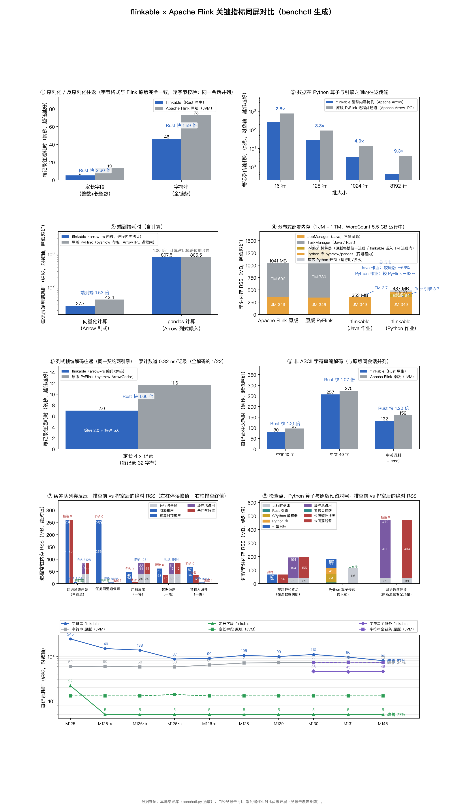

# flinkable × Apache Flink 关键指标同屏对比（benchctl 生成）

环境：见 flinkbench/README.md（口径随 run 记录在库）

## 指标明细（每项取最近一次摄取值）

| 指标 | 度量 | 数值 | 方向 |
| --- | --- | --- | --- |
| 序列化往返：定长字段（整数+长整数） | Apache Flink 原版（JVM） | 13 纳秒/记录 | 越低越好 |
| 序列化往返：定长字段（整数+长整数） | 原版/flinkable 耗时比 | 2.6 倍 | 越高越好 |
| 序列化往返：定长字段（整数+长整数） | flinkable（Rust 原生） | 5 纳秒/记录 | 越低越好 |
| 序列化往返：字符串（含构造） | Apache Flink 原版（JVM） | 73 纳秒/记录 | 越低越好 |
| 序列化往返：字符串（含构造） | 原版/flinkable 耗时比 | 0.91 倍 | 越高越好 |
| 序列化往返：字符串（含构造） | flinkable（Rust 原生） | 80 纳秒/记录 | 越低越好 |
| 算子间数据传输（批大小 16 行） | 原版 PyFlink 进程间通道（Apache Arrow IPC） | 754.8 纳秒/记录 | 越低越好 |
| 算子间数据传输（批大小 16 行） | flinkable 引擎内零拷贝 | 268.5 纳秒/记录 | 越低越好 |
| 算子间数据传输（批大小 16 行） | 传输耗时比（原版/flinkable） | 2.81 倍 | 越高越好 |
| 算子间数据传输（批大小 128 行） | 原版 PyFlink 进程间通道（Apache Arrow IPC） | 92 纳秒/记录 | 越低越好 |
| 算子间数据传输（批大小 128 行） | flinkable 引擎内零拷贝 | 28 纳秒/记录 | 越低越好 |
| 算子间数据传输（批大小 128 行） | 传输耗时比（原版/flinkable） | 3.29 倍 | 越高越好 |
| 算子间数据传输（批大小 1024 行） | 原版 PyFlink 进程间通道（Apache Arrow IPC） | 13.9 纳秒/记录 | 越低越好 |
| 算子间数据传输（批大小 1024 行） | flinkable 引擎内零拷贝 | 3.4 纳秒/记录 | 越低越好 |
| 算子间数据传输（批大小 1024 行） | 传输耗时比（原版/flinkable） | 4.05 倍 | 越高越好 |
| 算子间数据传输（批大小 8192 行） | 原版 PyFlink 进程间通道（Apache Arrow IPC） | 4 纳秒/记录 | 越低越好 |
| 算子间数据传输（批大小 8192 行） | flinkable 引擎内零拷贝 | 0.4 纳秒/记录 | 越低越好 |
| 算子间数据传输（批大小 8192 行） | 传输耗时比（原版/flinkable） | 9.27 倍 | 越高越好 |
| 端到端耗时（向量化计算，Apache Arrow） | 端到端耗时比（原版/flinkable） | 1.53 倍 | 越高越好 |
| 端到端耗时（向量化计算，Apache Arrow） | 原版 PyFlink 端到端 | 42.4 纳秒/记录 | 越低越好 |
| 端到端耗时（向量化计算，Apache Arrow） | flinkable 端到端 | 27.7 纳秒/记录 | 越低越好 |
| 端到端耗时（pandas 计算） | 端到端耗时比（原版/flinkable） | 1 倍 | 越高越好 |
| 端到端耗时（pandas 计算） | 原版 PyFlink 端到端 | 805.5 纳秒/记录 | 越低越好 |
| 端到端耗时（pandas 计算） | flinkable 端到端 | 807.5 纳秒/记录 | 越低越好 |
| 引擎侧常驻内存 RSS | Apache Flink 原版（JVM） | 406 MB | 越低越好 |
| 引擎侧常驻内存 RSS | flinkable（Rust 原生） | 4 MB | 越低越好 |
| 列式帧编码（Apache Arrow） | 每记录耗时 | 13.92 纳秒/记录 | 越低越好 |
| 列式帧编码（Apache Arrow） | 吞吐量 | 2270 MiB/s | 越高越好 |
| 列式帧解码（Apache Arrow） | 每字段耗时 | 3.914 纳秒/字段 | 越低越好 |
| 列式帧解码（Apache Arrow） | 每记录耗时 | 15.66 纳秒/记录 | 越低越好 |
| 列式帧解码（Apache Arrow） | 吞吐量 | 2018 MiB/s | 越高越好 |
| 线上字节量 | 每记录线上字节 | 33.14 字节/记录 | 越低越好 |
| shuffle 随机取数 | 每字段耗时 | 0.62 纳秒/字段 | 越低越好 |
| shuffle 随机取数 | 每记录耗时 | 2.48 纳秒/记录 | 越低越好 |
| shuffle 随机取数 | 吞吐量 | 403.4 百万记录/秒 | 越高越好 |
| 算子间数据传输（批接口） | 仅导出 | 0.6 纳秒/记录 | 越低越好 |
| 算子间数据传输（批接口） | 导出吞吐量 | 5.202e+04 MiB/s | 越高越好 |
| 算子间数据传输（批接口） | 原版 PyFlink 进程间通道（Apache Arrow IPC） | 21.2 纳秒/记录 | 越低越好 |
| 算子间数据传输（批接口） | 进程间通道吞吐量 | 1476 MiB/s | 越高越好 |
| 算子间数据传输（批接口） | 零拷贝吞吐量 | 1.792e+04 MiB/s | 越高越好 |
| 算子间数据传输（批接口） | flinkable 引擎内零拷贝 | 1.7 纳秒/记录 | 越低越好 |
| 算子间数据传输（批接口） | 传输耗时比（原版/flinkable） | 12.14 倍 | 越高越好 |
| 算子融合（chaining） | 链式（未融合） | 120 纳秒/记录 | 越低越好 |
| 算子融合（chaining） | 融合后 | 72 纳秒/记录 | 越低越好 |
| 算子融合（chaining） | 加速比 | 1.67 倍 | 越高越好 |
| 网络缓冲记账 | 每记录耗时 | 72 纳秒/记录 | 越低越好 |
| 跨任务通道往返下限 | 每记录耗时 | 1.799e+04 纳秒/记录 | 越低越好 |
| 序列化往返（自有缓冲形态，历史基线）：定长字段 | flinkable（Rust 原生） | 21 纳秒/记录 | 越低越好 |
| 序列化往返（自有缓冲形态，历史基线）：字符串 | flinkable（Rust 原生） | 117 纳秒/记录 | 越低越好 |
| 解码通道：ASCII 12 字节 | flinkable（Rust 原生） | 35 纳秒/记录 | 越低越好 |
| 解码通道：ASCII 12 字节 | flinkable（改造前） | 32 纳秒/记录 | 越低越好 |
| 解码通道：ASCII 12 字节 | flinkable（借用零分配） | 22 纳秒/记录 | 越低越好 |
| 解码通道：ASCII 47 字节 | flinkable（Rust 原生） | 38 纳秒/记录 | 越低越好 |
| 解码通道：ASCII 47 字节 | flinkable（改造前） | 47 纳秒/记录 | 越低越好 |
| 解码通道：ASCII 47 字节 | flinkable（借用零分配） | 24 纳秒/记录 | 越低越好 |
| 解码通道：中文 52 字 | flinkable（Rust 原生） | 176 纳秒/记录 | 越低越好 |
| 解码通道：中文 52 字 | flinkable（改造前） | 406 纳秒/记录 | 越低越好 |
| 解码通道：中文 52 字 | flinkable（借用零分配） | 183 纳秒/记录 | 越低越好 |
| 解码通道：中文 10 字 | flinkable（Rust 原生） | 51 纳秒/记录 | 越低越好 |
| 解码通道：中文 10 字 | flinkable（改造前） | 133 纳秒/记录 | 越低越好 |
| 解码通道：中文 10 字 | flinkable（借用零分配） | 54 纳秒/记录 | 越低越好 |
| 解码通道：emoji | flinkable（Rust 原生） | 42 纳秒/记录 | 越低越好 |
| 解码通道：emoji | flinkable（改造前） | 53 纳秒/记录 | 越低越好 |
| 解码通道：emoji | flinkable（借用零分配） | 45 纳秒/记录 | 越低越好 |
| 解码通道：日文 16 字 | flinkable（Rust 原生） | 75 纳秒/记录 | 越低越好 |
| 解码通道：日文 16 字 | flinkable（改造前） | 172 纳秒/记录 | 越低越好 |
| 解码通道：日文 16 字 | flinkable（借用零分配） | 78 纳秒/记录 | 越低越好 |
| 解码通道：中英混排 + emoji | flinkable（Rust 原生） | 73 纳秒/记录 | 越低越好 |
| 解码通道：中英混排 + emoji | flinkable（改造前） | 183 纳秒/记录 | 越低越好 |
| 解码通道：中英混排 + emoji | flinkable（借用零分配） | 76 纳秒/记录 | 越低越好 |
| 编码通道：ASCII 12 字节 | flinkable（Rust 原生） | 8 纳秒/记录 | 越低越好 |
| 编码通道：ASCII 12 字节 | flinkable（改造前） | 7 纳秒/记录 | 越低越好 |
| 编码通道：ASCII 47 字节 | flinkable（Rust 原生） | 9 纳秒/记录 | 越低越好 |
| 编码通道：ASCII 47 字节 | flinkable（改造前） | 9 纳秒/记录 | 越低越好 |
| 编码通道：中文 52 字 | flinkable（Rust 原生） | 213 纳秒/记录 | 越低越好 |
| 编码通道：中文 52 字 | flinkable（改造前） | 340 纳秒/记录 | 越低越好 |
| 编码通道：中文 10 字 | flinkable（Rust 原生） | 44 纳秒/记录 | 越低越好 |
| 编码通道：中文 10 字 | flinkable（改造前） | 66 纳秒/记录 | 越低越好 |
| 编码通道：emoji | flinkable（Rust 原生） | 22 纳秒/记录 | 越低越好 |
| 编码通道：emoji | flinkable（改造前） | 36 纳秒/记录 | 越低越好 |
| 编码通道：日文 16 字 | flinkable（Rust 原生） | 76 纳秒/记录 | 越低越好 |
| 编码通道：日文 16 字 | flinkable（改造前） | 95 纳秒/记录 | 越低越好 |
| 编码通道：中英混排 + emoji | flinkable（Rust 原生） | 79 纳秒/记录 | 越低越好 |
| 编码通道：中英混排 + emoji | flinkable（改造前） | 88 纳秒/记录 | 越低越好 |
| 反压：广播扇出·一慢 | 恢复排空每记录耗时 | 3.303e+04 ns/buffer | 越低越好 |
| 反压：广播扇出·一慢 | hot_mb | 16.4 MB | 越低越好 |
| 反压：广播扇出·一慢 | max_healthy_mb | 9.3 MB | 越低越好 |
| 反压：广播扇出·一慢 | 每缓冲写入耗时（畅通） | 1.278e+04 ns/buffer | 越低越好 |
| 反压：广播扇出·一慢 | 被拒写入次数（缓冲池背压信号） | 0 buffers | 越低越好 |
| 反压：广播扇出·一慢 | 恢复后队列残留 | 0 MB | 越低越好 |
| 反压：广播扇出·一慢 | rss_after_mb | 5.9 MB | 越低越好 |
| 反压：广播扇出·一慢 | rss_base_mb | 4 MB | 越低越好 |
| 反压：广播扇出·一慢 | rss_peak_mb | 46 MB | 越低越好 |
| 反压：原版广播扇出·一慢 | hot_mb | 0.8 MB | 越低越好 |
| 反压：原版广播扇出·一慢 | max_healthy_mb | 1.2 MB | 越低越好 |
| 反压：原版广播扇出·一慢 | 每缓冲写入耗时（畅通） | 4.035e+05 ns/buffer | 越低越好 |
| 反压：原版广播扇出·一慢 | 被拒写入次数（缓冲池背压信号） | 1984 buffers | 越低越好 |
| 反压：原版广播扇出·一慢 | rss_after_mb | 83.7 MB | 越低越好 |
| 反压：原版广播扇出·一慢 | rss_base_mb | 39.4 MB | 越低越好 |
| 反压：原版广播扇出·一慢 | rss_peak_mb | 83.2 MB | 越低越好 |
| 反压：非对齐检查点 × 在途数据 | backlog_mb | 64 MB | 越低越好 |
| 反压：非对齐检查点 × 在途数据 | capture_ns | 48 ns/buffer | 越低越好 |
| 反压：非对齐检查点 × 在途数据 | captured_mb | 64 MB | 越低越好 |
| 反压：非对齐检查点 × 在途数据 | 被拒写入次数（缓冲池背压信号） | 0 buffers | 越低越好 |
| 反压：非对齐检查点 × 在途数据 | 恢复后队列残留 | 64 MB | 越低越好 |
| 反压：非对齐检查点 × 在途数据 | rss_after_mb | 67.3 MB | 越低越好 |
| 反压：非对齐检查点 × 在途数据 | rss_base_mb | 3.1 MB | 越低越好 |
| 反压：非对齐检查点 × 在途数据 | rss_peak_mb | 67.3 MB | 越低越好 |
| 反压：非对齐检查点 × 在途数据 | rss_peek_mb | 67.3 MB | 越低越好 |
| 反压：非对齐检查点 × 在途数据 | rss_queued_mb | 67.2 MB | 越低越好 |
| 反压：原版非对齐检查点 × 在途数据 | backlog_mb | 64 MB | 越低越好 |
| 反压：原版非对齐检查点 × 在途数据 | capture_ns | 3.173e+04 ns/buffer | 越低越好 |
| 反压：原版非对齐检查点 × 在途数据 | captured_mb | 64 MB | 越低越好 |
| 反压：原版非对齐检查点 × 在途数据 | 恢复后队列残留 | 64 MB | 越低越好 |
| 反压：原版非对齐检查点 × 在途数据 | rss_after_mb | 194.6 MB | 越低越好 |
| 反压：原版非对齐检查点 × 在途数据 | rss_base_mb | 39.4 MB | 越低越好 |
| 反压：原版非对齐检查点 × 在途数据 | rss_peak_mb | 193.5 MB | 越低越好 |
| 反压：原版非对齐检查点 × 在途数据 | rss_queued_mb | 193.2 MB | 越低越好 |
| 反压吸收：任务间通道停读 | 反压期间引擎吸收（队列驻留） | 256 MB | 越低越好 |
| 反压吸收：任务间通道停读 | backlog_mb | 256 MB | 越低越好 |
| 反压吸收：任务间通道停读 | 恢复排空每记录耗时 | 1128 ns/record | 越低越好 |
| 反压吸收：任务间通道停读 | 每缓冲写入耗时（畅通） | 9437 ns/record | 越低越好 |
| 反压吸收：任务间通道停读 | 被拒写入次数（缓冲池背压信号） | 0 records | 越低越好 |
| 反压吸收：任务间通道停读 | 恢复后队列残留 | 0 MB | 越低越好 |
| 反压吸收：任务间通道停读 | rss_after_mb | 3.5 MB | 越低越好 |
| 反压吸收：任务间通道停读 | rss_base_mb | 3 MB | 越低越好 |
| 反压吸收：任务间通道停读 | rss_peak_mb | 258.8 MB | 越低越好 |
| 反压吸收：任务间通道停读 | 恢复后常驻内存未回落 | 0.5 MB | 越低越好 |
| 反压吸收：任务间通道停读 | 反压期间进程常驻内存增量 | 256.5 MB | 越低越好 |
| 反压：任务间通道停读（预算封顶） | backlog_mb | 2 MB | 越低越好 |
| 反压：任务间通道停读（预算封顶） | 恢复排空每记录耗时 | 457 ns/record | 越低越好 |
| 反压：任务间通道停读（预算封顶） | 每缓冲写入耗时（畅通） | 441 ns/record | 越低越好 |
| 反压：任务间通道停读（预算封顶） | 被拒写入次数（缓冲池背压信号） | 8128 records | 越低越好 |
| 反压：任务间通道停读（预算封顶） | 恢复后队列残留 | 0 MB | 越低越好 |
| 反压：任务间通道停读（预算封顶） | rss_after_mb | 4.3 MB | 越低越好 |
| 反压：任务间通道停读（预算封顶） | rss_base_mb | 3.2 MB | 越低越好 |
| 反压：任务间通道停读（预算封顶） | rss_peak_mb | 5.1 MB | 越低越好 |
| 反压吸收（网络 shuffle 通道） | 反压期间引擎吸收（队列驻留） | 256.4 MB | 越低越好 |
| 反压吸收（网络 shuffle 通道） | 恢复排空每记录耗时 | 8956 ns/buffer | 越低越好 |
| 反压吸收（网络 shuffle 通道） | 畅通时引擎内缓冲（对照） | 256.4 MB | 越低越好 |
| 反压吸收（网络 shuffle 通道） | 每缓冲写入耗时（畅通） | 1.4e+04 ns/buffer | 越低越好 |
| 反压吸收（网络 shuffle 通道） | 被拒写入次数（缓冲池背压信号） | 0 buffers | 越低越好 |
| 反压吸收（网络 shuffle 通道） | 恢复后队列残留 | 0 MB | 越低越好 |
| 反压吸收（网络 shuffle 通道） | 畅通时进程常驻内存增量（对照） | 256.8 MB | 越低越好 |
| 反压吸收（网络 shuffle 通道） | 恢复后常驻内存未回落 | 256 MB | 越低越好 |
| 反压吸收（网络 shuffle 通道） | 反压期间进程常驻内存增量 | 256.8 MB | 越低越好 |
| 反压吸收（网络 shuffle 通道） | 每缓冲写入耗时（反压中） | 1.42e+04 ns/buffer | 越低越好 |
| 反压吸收：原版（缓冲池按预算封顶） | 反压期间引擎吸收（队列驻留） | 2 MB | 越低越好 |
| 反压吸收：原版（缓冲池按预算封顶） | 恢复排空每记录耗时 | 31 ns/buffer | 越低越好 |
| 反压吸收：原版（缓冲池按预算封顶） | 每缓冲写入耗时（畅通） | 3315 ns/buffer | 越低越好 |
| 反压吸收：原版（缓冲池按预算封顶） | 被拒写入次数（缓冲池背压信号） | 8128 buffers | 越低越好 |
| 反压吸收：原版（缓冲池按预算封顶） | reservation_mb | 42.5 MB | 越低越好 |
| 反压吸收：原版（缓冲池按预算封顶） | 恢复后常驻内存未回落 | 43.9 MB | 越低越好 |
| 反压吸收：原版（缓冲池按预算封顶） | 反压期间进程常驻内存增量 | 43.7 MB | 越低越好 |
| 反压吸收：原版（缓冲池可容纳全场景） | 反压期间引擎吸收（队列驻留） | 256.5 MB | 越低越好 |
| 反压吸收：原版（缓冲池可容纳全场景） | 恢复排空每记录耗时 | 815 ns/buffer | 越低越好 |
| 反压吸收：原版（缓冲池可容纳全场景） | heap_committed_mb | 244 MB | 越低越好 |
| 反压吸收：原版（缓冲池可容纳全场景） | heap_used_mb | 132.5 MB | 越低越好 |
| 反压吸收：原版（缓冲池可容纳全场景） | 每缓冲写入耗时（畅通） | 1.156e+04 ns/buffer | 越低越好 |
| 反压吸收：原版（缓冲池可容纳全场景） | 被拒写入次数（缓冲池背压信号） | 0 buffers | 越低越好 |
| 反压吸收：原版（缓冲池可容纳全场景） | 恢复后常驻内存未回落 | 389.1 MB | 越低越好 |
| 反压吸收：原版（缓冲池可容纳全场景） | 反压期间进程常驻内存增量 | 389 MB | 越低越好 |
| 反压：生产者阻塞唤醒（预算满时停读） | 生产者累计停读时长 | 5.007e+07 ns | 越低越好 |
| 反压：生产者阻塞唤醒（预算满时停读） | 停读期间进程常驻内存 RSS | 3.1 MB | 越低越好 |
| 反压：生产者阻塞唤醒（预算满时停读） | 预算腾出后唤醒生产者耗时 | 4.42e+04 ns | 越低越好 |
| 反压：Python 算子停读（嵌入式） | backlog_mb | 64 MB | 越低越好 |
| 反压：Python 算子停读（嵌入式） | drain_ms | 2 ms | 越低越好 |
| 反压：Python 算子停读（嵌入式） | rss_after_mb | 117.2 MB | 越低越好 |
| 反压：Python 算子停读（嵌入式） | rss_base_mb | 116.2 MB | 越低越好 |
| 反压：Python 算子停读（嵌入式） | rss_peak_mb | 180.4 MB | 越低越好 |
| 反压：原版网络通道·下游停读（缓冲池预留全场景） | backlog_mb | 299.2 MB | 越低越好 |
| 反压：原版网络通道·下游停读（缓冲池预留全场景） | 恢复排空每记录耗时 | 710 ns/buffer | 越低越好 |
| 反压：原版网络通道·下游停读（缓冲池预留全场景） | 每缓冲写入耗时（畅通） | 1.465e+04 ns/buffer | 越低越好 |
| 反压：原版网络通道·下游停读（缓冲池预留全场景） | 被拒写入次数（缓冲池背压信号） | 0 buffers | 越低越好 |
| 反压：原版网络通道·下游停读（缓冲池预留全场景） | rss_after_mb | 473 MB | 越低越好 |
| 反压：原版网络通道·下游停读（缓冲池预留全场景） | rss_base_mb | 39.4 MB | 越低越好 |
| 反压：原版网络通道·下游停读（缓冲池预留全场景） | rss_peak_mb | 472.1 MB | 越低越好 |
| 反压：数据倾斜·一热 | 恢复排空每记录耗时 | 1.049e+04 ns/buffer | 越低越好 |
| 反压：数据倾斜·一热 | hot_mb | 57.8 MB | 越低越好 |
| 反压：数据倾斜·一热 | max_healthy_mb | 0 MB | 越低越好 |
| 反压：数据倾斜·一热 | 每缓冲写入耗时（畅通） | 1.306e+04 ns/buffer | 越低越好 |
| 反压：数据倾斜·一热 | 被拒写入次数（缓冲池背压信号） | 0 buffers | 越低越好 |
| 反压：数据倾斜·一热 | 恢复后队列残留 | 0 MB | 越低越好 |
| 反压：数据倾斜·一热 | rss_after_mb | 36.3 MB | 越低越好 |
| 反压：数据倾斜·一热 | rss_base_mb | 4 MB | 越低越好 |
| 反压：数据倾斜·一热 | rss_peak_mb | 61.9 MB | 越低越好 |
| 反压：原版数据倾斜·一热 | hot_mb | 2 MB | 越低越好 |
| 反压：原版数据倾斜·一热 | max_healthy_mb | 0 MB | 越低越好 |
| 反压：原版数据倾斜·一热 | 每缓冲写入耗时（畅通） | 3.83e+05 ns/buffer | 越低越好 |
| 反压：原版数据倾斜·一热 | 被拒写入次数（缓冲池背压信号） | 1984 buffers | 越低越好 |
| 反压：原版数据倾斜·一热 | rss_after_mb | 84.8 MB | 越低越好 |
| 反压：原版数据倾斜·一热 | rss_base_mb | 39.4 MB | 越低越好 |
| 反压：原版数据倾斜·一热 | rss_peak_mb | 84.2 MB | 越低越好 |
| 反压：网络通道·信用充足（写队列积压） | backlog_mb | 256.4 MB | 越低越好 |
| 反压：网络通道·信用充足（写队列积压） | 每缓冲写入耗时（畅通） | 1.191e+04 ns/buffer | 越低越好 |
| 反压：网络通道·信用充足（写队列积压） | rss_base_mb | 4 MB | 越低越好 |
| 反压：网络通道·信用充足（写队列积压） | rss_peak_mb | 260.7 MB | 越低越好 |
| 反压：网络通道·下游停读 | backlog_mb | 256.4 MB | 越低越好 |
| 反压：网络通道·下游停读 | 恢复排空每记录耗时 | 8812 ns/buffer | 越低越好 |
| 反压：网络通道·下游停读 | 每缓冲写入耗时（畅通） | 1.174e+04 ns/buffer | 越低越好 |
| 反压：网络通道·下游停读 | 被拒写入次数（缓冲池背压信号） | 0 buffers | 越低越好 |
| 反压：网络通道·下游停读 | 恢复后队列残留 | 0 MB | 越低越好 |
| 反压：网络通道·下游停读 | rss_after_mb | 259.9 MB | 越低越好 |
| 反压：网络通道·下游停读 | rss_base_mb | 4.1 MB | 越低越好 |
| 反压：网络通道·下游停读 | rss_peak_mb | 260.7 MB | 越低越好 |
| 反压：网络通道·下游停读（生产者预算封顶） | backlog_mb | 2 MB | 越低越好 |
| 反压：网络通道·下游停读（生产者预算封顶） | 恢复排空每记录耗时 | 1.391e+04 ns/buffer | 越低越好 |
| 反压：网络通道·下游停读（生产者预算封顶） | 每缓冲写入耗时（畅通） | 879 ns/buffer | 越低越好 |
| 反压：网络通道·下游停读（生产者预算封顶） | 被拒写入次数（缓冲池背压信号） | 8128 buffers | 越低越好 |
| 反压：网络通道·下游停读（生产者预算封顶） | 恢复后队列残留 | 0 MB | 越低越好 |
| 反压：网络通道·下游停读（生产者预算封顶） | rss_after_mb | 3.9 MB | 越低越好 |
| 反压：网络通道·下游停读（生产者预算封顶） | rss_base_mb | 3.8 MB | 越低越好 |
| 反压：网络通道·下游停读（生产者预算封顶） | rss_peak_mb | 5.9 MB | 越低越好 |
| 反压：原版网络通道·下游停读（缓冲池封顶） | backlog_mb | 2 MB | 越低越好 |
| 反压：原版网络通道·下游停读（缓冲池封顶） | 恢复排空每记录耗时 | 30 ns/buffer | 越低越好 |
| 反压：原版网络通道·下游停读（缓冲池封顶） | 每缓冲写入耗时（畅通） | 2962 ns/buffer | 越低越好 |
| 反压：原版网络通道·下游停读（缓冲池封顶） | 被拒写入次数（缓冲池背压信号） | 8128 buffers | 越低越好 |
| 反压：原版网络通道·下游停读（缓冲池封顶） | reservation_mb | 42.2 MB | 越低越好 |
| 反压：原版网络通道·下游停读（缓冲池封顶） | rss_after_mb | 83 MB | 越低越好 |
| 反压：原版网络通道·下游停读（缓冲池封顶） | rss_base_mb | 39.4 MB | 越低越好 |
| 反压：原版网络通道·下游停读（缓冲池封顶） | rss_peak_mb | 82.8 MB | 越低越好 |
| 反压：多输入归并·一慢 | 恢复排空每记录耗时 | 519 ns/record | 越低越好 |
| 反压：多输入归并·一慢 | hot_mb | 64 MB | 越低越好 |
| 反压：多输入归并·一慢 | max_healthy_mb | 0 MB | 越低越好 |
| 反压：多输入归并·一慢 | 每缓冲写入耗时（畅通） | 2731 ns/record | 越低越好 |
| 反压：多输入归并·一慢 | 被拒写入次数（缓冲池背压信号） | 0 buffers | 越低越好 |
| 反压：多输入归并·一慢 | 恢复后队列残留 | 0 MB | 越低越好 |
| 反压：多输入归并·一慢 | rss_after_mb | 35.3 MB | 越低越好 |
| 反压：多输入归并·一慢 | rss_base_mb | 3.1 MB | 越低越好 |
| 反压：多输入归并·一慢 | rss_peak_mb | 67.1 MB | 越低越好 |
| 反压：多输入归并·一慢（预算封顶） | 恢复排空每记录耗时 | 645 ns/record | 越低越好 |
| 反压：多输入归并·一慢（预算封顶） | hot_mb | 2 MB | 越低越好 |
| 反压：多输入归并·一慢（预算封顶） | max_healthy_mb | 0 MB | 越低越好 |
| 反压：多输入归并·一慢（预算封顶） | 每缓冲写入耗时（畅通） | 607 ns/record | 越低越好 |
| 反压：多输入归并·一慢（预算封顶） | 被拒写入次数（缓冲池背压信号） | 1984 records | 越低越好 |
| 反压：多输入归并·一慢（预算封顶） | 恢复后队列残留 | 0 MB | 越低越好 |
| 反压：多输入归并·一慢（预算封顶） | rss_after_mb | 4 MB | 越低越好 |
| 反压：多输入归并·一慢（预算封顶） | rss_base_mb | 2.9 MB | 越低越好 |
| 反压：多输入归并·一慢（预算封顶） | rss_peak_mb | 4.9 MB | 越低越好 |
| shuffle 序列化往返（定长 4 列记录） | flinkable 解码段 | 5 纳秒/记录 | 越低越好 |
| shuffle 序列化往返（定长 4 列记录） | flinkable 编码段 | 2 纳秒/记录 | 越低越好 |
| shuffle 序列化往返（定长 4 列记录） | Apache Flink 原版（JVM） | 10 纳秒/记录 | 越低越好 |
| shuffle 序列化往返（定长 4 列记录） | 原版/flinkable 耗时比 | 1.43 倍 | 越高越好 |
| shuffle 序列化往返（定长 4 列记录） | flinkable（Rust 原生） | 7 纳秒/记录 | 越低越好 |
| 列式帧编解码往返（Python 算子线格式） | 原版 PyFlink（ArrowCoder，编+解） | 11.63 纳秒/记录 | 越低越好 |
| 列式帧编解码往返（Python 算子线格式） | 原版 PyFlink 解码段（ArrowCoder） | 2.15 纳秒/记录 | 越低越好 |
| 列式帧编解码往返（Python 算子线格式） | 原版 PyFlink 编码段（ArrowCoder） | 9.48 纳秒/记录 | 越低越好 |
| 嵌入式 Python 内存构成 | batch_total_mb | 116.1 MB | 越低越好 |
| 嵌入式 Python 内存构成 | engine_base_mb | 8.6 MB | 越低越好 |
| 嵌入式 Python 内存构成 | interp_total_mb | 72.3 MB | 越低越好 |
| 嵌入式 Python 内存构成 | libs_total_mb | 114.7 MB | 越低越好 |
| 分布式部署常驻内存：JobManager（Java） | Apache Flink 原版（JVM） | 349 MB | 越低越好 |
| 分布式部署常驻内存：JobManager（Java） | 原版/flinkable 耗时比 | 1 倍 | 越高越好 |
| 分布式部署常驻内存：JobManager（Java） | flink_pyflink | 345.5 MB | 越低越好 |
| 分布式部署常驻内存：JobManager（Java） | flinkable（Rust 原生） | 349 MB | 越低越好 |
| memory_py_rss | flink_pyflink | 191.9 MB | 越低越好 |
| 分布式部署常驻内存：TaskManager | Apache Flink 原版（JVM） | 692 MB | 越低越好 |
| 分布式部署常驻内存：TaskManager | 原版/flinkable 耗时比 | 187 倍 | 越高越好 |
| 分布式部署常驻内存：TaskManager | flink_pyflink | 780 MB | 越低越好 |
| 分布式部署常驻内存：TaskManager | flinkable（Rust 原生） | 3.7 MB | 越低越好 |
| 分布式部署常驻内存：TaskManager | flinkable_py | 138.3 MB | 越低越好 |
| serde_bulk4_count | flinkable（Rust 原生） | 0.321 纳秒/记录 | 越低越好 |
| 序列化往返：中文 10 字（非 ASCII） | Apache Flink 原版（JVM） | 97 纳秒/记录 | 越低越好 |
| 序列化往返：中文 10 字（非 ASCII） | 原版/flinkable 耗时比 | 1.21 倍 | 越高越好 |
| 序列化往返：中文 10 字（非 ASCII） | flinkable（Rust 原生） | 80 纳秒/记录 | 越低越好 |
| 序列化往返：中文 40 字（非 ASCII） | Apache Flink 原版（JVM） | 275 纳秒/记录 | 越低越好 |
| 序列化往返：中文 40 字（非 ASCII） | 原版/flinkable 耗时比 | 1.07 倍 | 越高越好 |
| 序列化往返：中文 40 字（非 ASCII） | flinkable（Rust 原生） | 257 纳秒/记录 | 越低越好 |
| 序列化往返：中英混排 + emoji | Apache Flink 原版（JVM） | 159 纳秒/记录 | 越低越好 |
| 序列化往返：中英混排 + emoji | 原版/flinkable 耗时比 | 1.2 倍 | 越高越好 |
| 序列化往返：中英混排 + emoji | flinkable（Rust 原生） | 132 纳秒/记录 | 越低越好 |
| 序列化往返：字符串（仅编解码） | Apache Flink 原版（JVM） | 64 纳秒/记录 | 越低越好 |
| 序列化往返：字符串（仅编解码） | 原版/flinkable 耗时比 | 1.21 倍 | 越高越好 |
| 序列化往返：字符串（仅编解码） | flinkable（Rust 原生） | 53 纳秒/记录 | 越低越好 |
| 值构造项（基准开销，引擎不做构造） | Apache Flink 原版（JVM） | 13 纳秒/记录 | 越低越好 |
| 值构造项（基准开销，引擎不做构造） | 原版/flinkable 耗时比 | 0.52 倍 | 越高越好 |
| 值构造项（基准开销，引擎不做构造） | flinkable（Rust 原生） | 25 纳秒/记录 | 越低越好 |
| 序列化往返：字符串（全链条：构造+编解码） | Apache Flink 原版（JVM） | 73 纳秒/记录 | 越低越好 |
| 序列化往返：字符串（全链条：构造+编解码） | 原版/flinkable 耗时比 | 1.59 倍 | 越高越好 |
| 序列化往返：字符串（全链条：构造+编解码） | flinkable（Rust 原生） | 46 纳秒/记录 | 越低越好 |

## 非 ASCII 字符串全链条（与原版同会话、同形状、同纪律并列）

| 形状 | flinkable（Rust 原生） | Apache Flink 原版（JVM） | 原版/flinkable |
| --- | --- | --- | --- |
| 中文 10 字 | 80 纳秒/记录 | 97 纳秒/记录 | 1.21 倍 |
| 中文 40 字 | 257 纳秒/记录 | 275 纳秒/记录 | 1.07 倍 |
| 中英混排 + emoji | 132 纳秒/记录 | 159 纳秒/记录 | 1.20 倍 |

口径：整条链（值构造 + 编码 + 解码）每记录往返耗时，纳秒/记录；两腿取自同一次跨引擎对表运行，Rust 腿为池化批形制（生产形态），JVM 腿为 Flink `StringSerializer` 经 `DataOutputSerializer`/`DataInputDeserializer` 的完整往返。

## 编解码通道改造前后（同一二进制内的 A/B 腿）

| 形状 | 改造前 | 改造后 | 提速 | 借用零分配解码 |
| --- | --- | --- | --- | --- |
| 中文 10 字 | 199 | 95 | 52% | 54 |
| 中文 52 字 | 746 | 389 | 48% | 183 |
| 日文 16 字 | 267 | 151 | 43% | 78 |
| emoji | 89 | 64 | 28% | 45 |
| 中英混排 + emoji | 271 | 152 | 44% | 76 |
| ASCII 12 字节（对照） | 39 | 43 | -10% | 22 |
| ASCII 47 字节（对照） | 56 | 47 | 16% | 24 |

口径：仅编解码通道（纳秒/记录），不含值构造项；“改造前/改造后”为同一次运行内并列的 A/B 腿，避免跨会话机器状态漂移；“借用零分配解码”为解码不新建字符串的下界形态，仅作参照。

## 反压分型：停读期间与排空后的绝对内存

| 场景 | 引擎 | 基线 RSS | 反压峰值 | 排空后 | 队列/池驻留 | 快照额外拷贝 | 拒绝写入 |
| --- | --- | --- | --- | --- | --- | --- | --- |
| 网络通道停读（单通道） | flinkable | 4.1 | 260.7 | 259.9 | 256.4 | — | 0 次 |
| 网络通道停读（单通道） | flinkable（预算封顶） | 3.8 | 5.9 | 3.9 | 2.0 | — | 8128 次 |
| 网络通道停读（单通道） | 原版 Flink（池按预算封顶） | 39.4 | 82.8 | 83.0 | 2.0 | — | 8128 次 |
| 网络通道停读（单通道） | 原版 Flink（池预留全场景） | 39.4 | 472.1 | 473.0 | 299.2 | — | 0 次 |
| 广播扇出（一慢） | flinkable | 4.0 | 46.0 | 5.9 | 16.4 | — | 0 次 |
| 广播扇出（一慢） | 原版 Flink（每通道配额） | 39.4 | 83.2 | 83.7 | 0.8 | — | 1984 次 |
| 数据倾斜（一热） | flinkable | 4.0 | 61.9 | 36.3 | 57.8 | — | 0 次 |
| 数据倾斜（一热） | 原版 Flink（每通道配额） | 39.4 | 84.2 | 84.8 | 2.0 | — | 1984 次 |
| 多输入归并（一慢） | flinkable | 3.1 | 67.1 | 35.3 | 64.0 | — | 0 次 |
| 多输入归并（一慢） | flinkable（预算封顶） | 2.9 | 4.9 | 4.0 | 2.0 | — | 1984 次 |
| 非对齐检查点 × 在途数据 | flinkable | 3.1 | 67.3 | 67.3 | 64.0 | 0.0 | 0 次 |
| 非对齐检查点 × 在途数据 | 原版 Flink | 39.4 | 193.5 | 194.6 | 64.0 | 0.3 | — |
| 任务间通道停读 | flinkable | 3.0 | 258.8 | 3.5 | 256.0 | — | 0 次 |
| 任务间通道停读 | flinkable（预算封顶） | 3.2 | 5.1 | 4.3 | 2.0 | — | 8128 次 |
| Python 算子停读（嵌入式） | flinkable | 116.2 | 180.4 | 117.2 | 64.0 | — | — |

口径：全部为**同一进程的绝对常驻内存 RSS**（`/proc/self/statm`），三段采样——停读前基线、停读期间峰值、恢复排空后终值；不再报告增量。原版对照腿在**独立 JVM 进程**逐场景运行，基线互不污染。要点：原版“反压时内存涨得快”发生在**构造期预留**（缓冲池一次性握段），“回收慢甚至不回收”是**池化复用**（段不回 OS，全程 GC 仅 2–3 次），均非 GC 问题；每通道配额（`maxBuffersPerChannel`）使一慢/一热被封顶在 2 MB 级，拒绝 1984 次。M149 已为 flinkable 补上同形信号：任务间通道（Exchange）与网络 shuffle 均有生产者侧预算封顶（`with_budget`/`try_produce`），三形状拒绝 8128/8128/1984 次与原版对照腿一致，RSS 仅 +2 MB 级且排空后全部回落基线——无界积压与残留两个缺口关闭。M150 进一步：①非对齐快照的 in-flight 数据改为 `bytes::Bytes` 引用计数共享，持久化拷贝从 64 MB 归零——capture 峰值由 2×（131.3）回落到 1×+0.1（67.3），与原版 BufferConsumer 共享同一段内存完全同形；②预算满时生产者不再只是被拒，而是在 emit 内**阻塞停读**（`push_blocking`，忠实 `requestBufferBuilderBlocking`），腾出预算后 44µs 唤醒、停读期间 RSS 持平基线——一个满队列就此逐级回传为端到端反压。未封顶形状排空后 RSS 是否回落取决于分配器能否归还连续空闲块（归并/广播回落，停读/倾斜部分保留），属碎片而非泄漏。嵌入式 Python 的构成（同会话探针，`RSS|embed`）：Rust 引擎基线 8.6 MB → CPython 解释器 63.7 MB → pyarrow/pandas 库 42.4 MB → 在途 Arrow 批 1.4 MB；Python 算子停读行的色块即按此拆分。

## 时间线趋势（同一指标随摄取次序，Codespeed 式核心视图）

| 指标 | 度量 | M124 | M125 | M126·a | M126·b | M126·c | M126·d | M128 | M129 | M130 | M131 | M146 | M147 | M147 | M148 flinkable 反压分型（RIG，绝对 RSS） | M148 原版 JVM 反压分型（RIG，逐场景独立进程） | M149 反压封顶与零拷贝捕获（RIG，绝对 RSS） | M150 capture去克隆+park（RIG） |
| --- | --- | --- | --- | --- | --- | --- | --- | --- | --- | --- | --- | --- | --- | --- | --- | --- | --- | --- |
| 序列化往返：字符串（含构造） | flinkable（Rust 原生） | — | 245 | 149 | 138 | 87 | 90 | 105 | 99 | 110 | 96 | 80 | — | — | — | — | — | — |
| 序列化往返：字符串（含构造） | Apache Flink 原版（JVM） | — | 59 | 60 | 58 | 58 | 64 | 71 | 72 | 72 | 74 | 73 | — | — | — | — | — | — |
| 序列化往返：定长字段（整数+长整数） | flinkable（Rust 原生） | — | 22 | 5 | 5 | 5 | 5 | 5 | 5 | 5 | 5 | 5 | — | — | — | — | — | — |
| 序列化往返：定长字段（整数+长整数） | Apache Flink 原版（JVM） | — | 13 | 13 | 13 | 14 | 13 | 13 | 13 | 13 | 13 | 13 | — | — | — | — | — | — |

## 回归检查（基线窗口算法，移植自上游 regression_report_v2）

| 指标 | 度量 | 状态 |
| --- | --- | --- |
| 序列化往返：定长字段（整数+长整数） | flinkable（Rust 原生） | 正常 |
| 序列化往返：字符串（含构造） | flinkable（Rust 原生） | 正常 |

另有 245 项序列摄取次数不足 5 次，按上游方法论不参与回归判定，仅计入趋势面板。

## 术语对照

| 报告用词 | Flink 文档对应 |
| --- | --- |
| 序列化 / 反序列化 | Serialization / Deserialization |
| 每记录耗时 | per-record latency |
| 批大小 | batch size |
| 零拷贝 | zero-copy（Apache Arrow） |
| 进程间通道 | inter-process data plane（Beam worker，Arrow IPC） |
| 常驻内存（RSS） | Resident Set Size |
| 改造前 / 改造后 | before / after（同一二进制内的 A/B 腿） |
| 借用零分配 | zero-copy decode，借用输入缓冲不新建字符串 |
| 值构造项 | 基准里构造输入对象的费用，非引擎开销 |
| 同会话 | 同一台机器、同一次运行内并列测量（跨会话不可比） |
| 非 ASCII 形状 | 中文 / 日文 / emoji（UTF-16 码元多字节形制） |
| 吞吐量 | throughput |
| shuffle 随机取数 | shuffle read（Arrow take） |

