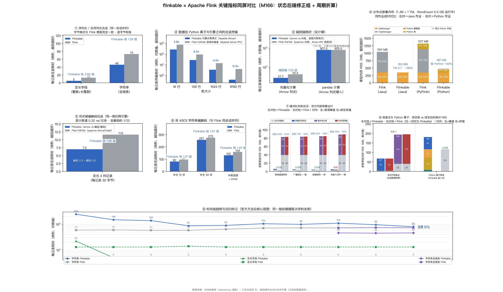
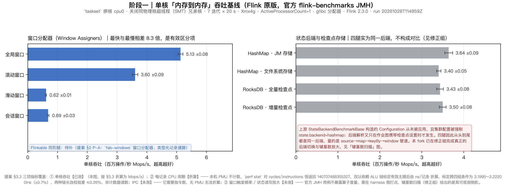
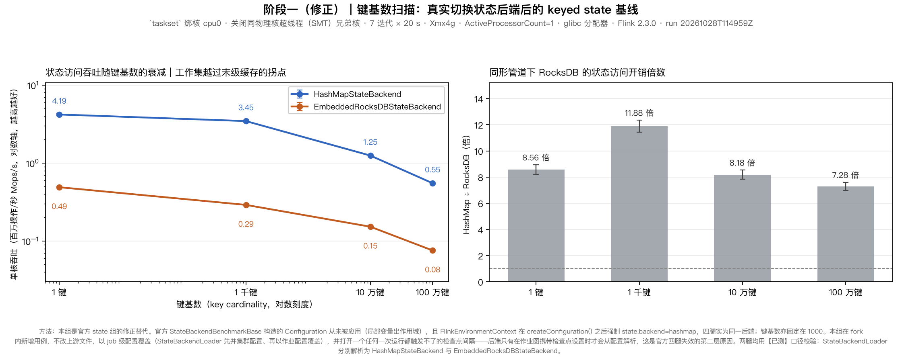

# flinkable × Apache Flink 关键指标同屏对比（M166：状态后端修正组 + 周期折算）

环境：见 flinkbench/README.md（口径随 run 记录在库）

## 指标明细（每项取最近一次摄取值）

| 指标 | 度量 | 数值 | 方向 |
| --- | --- | --- | --- |
| 序列化往返：定长字段（整数+长整数） | Flink | 13 纳秒/记录 | 越低越好 |
| 序列化往返：定长字段（整数+长整数） | Flink/Flinkable 耗时比 | 2.6 倍 | 越高越好 |
| 序列化往返：定长字段（整数+长整数） | Flinkable | 5 纳秒/记录 | 越低越好 |
| 序列化往返：字符串（含构造） | Flink | 73 纳秒/记录 | 越低越好 |
| 序列化往返：字符串（含构造） | Flink/Flinkable 耗时比 | 0.91 倍 | 越高越好 |
| 序列化往返：字符串（含构造） | Flinkable | 80 纳秒/记录 | 越低越好 |
| 算子间数据传输（批大小 16 行） | Flink PyFlink 进程间通道（Apache Arrow IPC） | 754.8 纳秒/记录 | 越低越好 |
| 算子间数据传输（批大小 16 行） | Flinkable 引擎内零拷贝 | 268.5 纳秒/记录 | 越低越好 |
| 算子间数据传输（批大小 16 行） | 传输耗时比（Flink/Flinkable） | 2.81 倍 | 越高越好 |
| 算子间数据传输（批大小 128 行） | Flink PyFlink 进程间通道（Apache Arrow IPC） | 92 纳秒/记录 | 越低越好 |
| 算子间数据传输（批大小 128 行） | Flinkable 引擎内零拷贝 | 28 纳秒/记录 | 越低越好 |
| 算子间数据传输（批大小 128 行） | 传输耗时比（Flink/Flinkable） | 3.29 倍 | 越高越好 |
| 算子间数据传输（批大小 1024 行） | Flink PyFlink 进程间通道（Apache Arrow IPC） | 13.9 纳秒/记录 | 越低越好 |
| 算子间数据传输（批大小 1024 行） | Flinkable 引擎内零拷贝 | 3.4 纳秒/记录 | 越低越好 |
| 算子间数据传输（批大小 1024 行） | 传输耗时比（Flink/Flinkable） | 4.05 倍 | 越高越好 |
| 算子间数据传输（批大小 8192 行） | Flink PyFlink 进程间通道（Apache Arrow IPC） | 4 纳秒/记录 | 越低越好 |
| 算子间数据传输（批大小 8192 行） | Flinkable 引擎内零拷贝 | 0.4 纳秒/记录 | 越低越好 |
| 算子间数据传输（批大小 8192 行） | 传输耗时比（Flink/Flinkable） | 9.27 倍 | 越高越好 |
| 端到端耗时（向量化计算，Apache Arrow） | 端到端耗时比（Flink/Flinkable） | 1.53 倍 | 越高越好 |
| 端到端耗时（向量化计算，Apache Arrow） | Flink PyFlink 端到端 | 42.4 纳秒/记录 | 越低越好 |
| 端到端耗时（向量化计算，Apache Arrow） | Flinkable 端到端 | 27.7 纳秒/记录 | 越低越好 |
| 端到端耗时（pandas 计算） | 端到端耗时比（Flink/Flinkable） | 1 倍 | 越高越好 |
| 端到端耗时（pandas 计算） | Flink PyFlink 端到端 | 805.5 纳秒/记录 | 越低越好 |
| 端到端耗时（pandas 计算） | Flinkable 端到端 | 807.5 纳秒/记录 | 越低越好 |
| 引擎侧常驻内存 RSS | Flink | 406 MB | 越低越好 |
| 引擎侧常驻内存 RSS | Flinkable | 4 MB | 越低越好 |
| 列式帧编码（Apache Arrow） | 每记录耗时 | 13.92 纳秒/记录 | 越低越好 |
| 列式帧编码（Apache Arrow） | 吞吐量 | 2270 MiB/s | 越高越好 |
| 列式帧解码（Apache Arrow） | 每字段耗时 | 3.914 纳秒/字段 | 越低越好 |
| 列式帧解码（Apache Arrow） | 每记录耗时 | 15.66 纳秒/记录 | 越低越好 |
| 列式帧解码（Apache Arrow） | 吞吐量 | 2018 MiB/s | 越高越好 |
| 线上字节量 | 每记录线上字节 | 33.14 字节/记录 | 越低越好 |
| shuffle 随机取数 | 每字段耗时 | 0.62 纳秒/字段 | 越低越好 |
| shuffle 随机取数 | 每记录耗时 | 2.48 纳秒/记录 | 越低越好 |
| shuffle 随机取数 | 吞吐量 | 403.4 百万记录/秒 | 越高越好 |
| 算子间数据传输（批接口） | 仅导出 | 0.6 纳秒/记录 | 越低越好 |
| 算子间数据传输（批接口） | 导出吞吐量 | 5.202e+04 MiB/s | 越高越好 |
| 算子间数据传输（批接口） | Flink PyFlink 进程间通道（Apache Arrow IPC） | 21.2 纳秒/记录 | 越低越好 |
| 算子间数据传输（批接口） | 进程间通道吞吐量 | 1476 MiB/s | 越高越好 |
| 算子间数据传输（批接口） | 零拷贝吞吐量 | 1.792e+04 MiB/s | 越高越好 |
| 算子间数据传输（批接口） | Flinkable 引擎内零拷贝 | 1.7 纳秒/记录 | 越低越好 |
| 算子间数据传输（批接口） | 传输耗时比（Flink/Flinkable） | 12.14 倍 | 越高越好 |
| 算子融合（chaining） | 链式（未融合） | 120 纳秒/记录 | 越低越好 |
| 算子融合（chaining） | 融合后 | 72 纳秒/记录 | 越低越好 |
| 算子融合（chaining） | 加速比 | 1.67 倍 | 越高越好 |
| 网络缓冲记账 | 每记录耗时 | 72 纳秒/记录 | 越低越好 |
| 跨任务通道往返下限 | 每记录耗时 | 1.799e+04 纳秒/记录 | 越低越好 |
| 序列化往返（自有缓冲形态，历史基线）：定长字段 | Flinkable | 21 纳秒/记录 | 越低越好 |
| 序列化往返（自有缓冲形态，历史基线）：字符串 | Flinkable | 117 纳秒/记录 | 越低越好 |
| 解码通道：ASCII 12 字节 | Flinkable | 35 纳秒/记录 | 越低越好 |
| 解码通道：ASCII 12 字节 | Flinkable（改造前） | 32 纳秒/记录 | 越低越好 |
| 解码通道：ASCII 12 字节 | Flinkable（借用零分配） | 22 纳秒/记录 | 越低越好 |
| 解码通道：ASCII 47 字节 | Flinkable | 38 纳秒/记录 | 越低越好 |
| 解码通道：ASCII 47 字节 | Flinkable（改造前） | 47 纳秒/记录 | 越低越好 |
| 解码通道：ASCII 47 字节 | Flinkable（借用零分配） | 24 纳秒/记录 | 越低越好 |
| 解码通道：中文 52 字 | Flinkable | 176 纳秒/记录 | 越低越好 |
| 解码通道：中文 52 字 | Flinkable（改造前） | 406 纳秒/记录 | 越低越好 |
| 解码通道：中文 52 字 | Flinkable（借用零分配） | 183 纳秒/记录 | 越低越好 |
| 解码通道：中文 10 字 | Flinkable | 51 纳秒/记录 | 越低越好 |
| 解码通道：中文 10 字 | Flinkable（改造前） | 133 纳秒/记录 | 越低越好 |
| 解码通道：中文 10 字 | Flinkable（借用零分配） | 54 纳秒/记录 | 越低越好 |
| 解码通道：emoji | Flinkable | 42 纳秒/记录 | 越低越好 |
| 解码通道：emoji | Flinkable（改造前） | 53 纳秒/记录 | 越低越好 |
| 解码通道：emoji | Flinkable（借用零分配） | 45 纳秒/记录 | 越低越好 |
| 解码通道：日文 16 字 | Flinkable | 75 纳秒/记录 | 越低越好 |
| 解码通道：日文 16 字 | Flinkable（改造前） | 172 纳秒/记录 | 越低越好 |
| 解码通道：日文 16 字 | Flinkable（借用零分配） | 78 纳秒/记录 | 越低越好 |
| 解码通道：中英混排 + emoji | Flinkable | 73 纳秒/记录 | 越低越好 |
| 解码通道：中英混排 + emoji | Flinkable（改造前） | 183 纳秒/记录 | 越低越好 |
| 解码通道：中英混排 + emoji | Flinkable（借用零分配） | 76 纳秒/记录 | 越低越好 |
| 编码通道：ASCII 12 字节 | Flinkable | 8 纳秒/记录 | 越低越好 |
| 编码通道：ASCII 12 字节 | Flinkable（改造前） | 7 纳秒/记录 | 越低越好 |
| 编码通道：ASCII 47 字节 | Flinkable | 9 纳秒/记录 | 越低越好 |
| 编码通道：ASCII 47 字节 | Flinkable（改造前） | 9 纳秒/记录 | 越低越好 |
| 编码通道：中文 52 字 | Flinkable | 213 纳秒/记录 | 越低越好 |
| 编码通道：中文 52 字 | Flinkable（改造前） | 340 纳秒/记录 | 越低越好 |
| 编码通道：中文 10 字 | Flinkable | 44 纳秒/记录 | 越低越好 |
| 编码通道：中文 10 字 | Flinkable（改造前） | 66 纳秒/记录 | 越低越好 |
| 编码通道：emoji | Flinkable | 22 纳秒/记录 | 越低越好 |
| 编码通道：emoji | Flinkable（改造前） | 36 纳秒/记录 | 越低越好 |
| 编码通道：日文 16 字 | Flinkable | 76 纳秒/记录 | 越低越好 |
| 编码通道：日文 16 字 | Flinkable（改造前） | 95 纳秒/记录 | 越低越好 |
| 编码通道：中英混排 + emoji | Flinkable | 79 纳秒/记录 | 越低越好 |
| 编码通道：中英混排 + emoji | Flinkable（改造前） | 88 纳秒/记录 | 越低越好 |
| 反压·广播扇出一慢（Flinkable，未设预算） | 恢复排空每记录耗时 | 3.491e+04 ns/buffer | 越低越好 |
| 反压·广播扇出一慢（Flinkable，未设预算） | hot_mb | 16.4 MB | 越低越好 |
| 反压·广播扇出一慢（Flinkable，未设预算） | max_healthy_mb | 9.3 MB | 越低越好 |
| 反压·广播扇出一慢（Flinkable，未设预算） | 每缓冲写入耗时（畅通） | 1.48e+04 ns/buffer | 越低越好 |
| 反压·广播扇出一慢（Flinkable，未设预算） | 被拒写入次数（缓冲池背压信号） | 0 buffers | 越低越好 |
| 反压·广播扇出一慢（Flinkable，未设预算） | 恢复后队列残留 | 0 MB | 越低越好 |
| 反压·广播扇出一慢（Flinkable，未设预算） | rss_after_mb | 5.9 MB | 越低越好 |
| 反压·广播扇出一慢（Flinkable，未设预算） | rss_base_mb | 3.8 MB | 越低越好 |
| 反压·广播扇出一慢（Flinkable，未设预算） | rss_peak_mb | 45.9 MB | 越低越好 |
| 反压·广播扇出一慢（Flinkable，设预算） | 恢复排空每记录耗时 | 3.886e+04 ns/buffer | 越低越好 |
| 反压·广播扇出一慢（Flinkable，设预算） | hot_mb | 0.5 MB | 越低越好 |
| 反压·广播扇出一慢（Flinkable，设预算） | max_healthy_mb | 0 MB | 越低越好 |
| 反压·广播扇出一慢（Flinkable，设预算） | 每缓冲写入耗时（畅通） | 1.576e+04 ns/buffer | 越低越好 |
| 反压·广播扇出一慢（Flinkable，设预算） | 被拒写入次数（缓冲池背压信号） | 1315 buffers | 越低越好 |
| 反压·广播扇出一慢（Flinkable，设预算） | 恢复后队列残留 | 0 MB | 越低越好 |
| 反压·广播扇出一慢（Flinkable，设预算） | rss_after_mb | 4.2 MB | 越低越好 |
| 反压·广播扇出一慢（Flinkable，设预算） | rss_base_mb | 4 MB | 越低越好 |
| 反压·广播扇出一慢（Flinkable，设预算） | rss_peak_mb | 5.3 MB | 越低越好 |
| 反压·广播扇出一慢（Flink，设预算） | hot_mb | 0.8 MB | 越低越好 |
| 反压·广播扇出一慢（Flink，设预算） | max_healthy_mb | 1.2 MB | 越低越好 |
| 反压·广播扇出一慢（Flink，设预算） | 每缓冲写入耗时（畅通） | 4.035e+05 ns/buffer | 越低越好 |
| 反压·广播扇出一慢（Flink，设预算） | 被拒写入次数（缓冲池背压信号） | 1984 buffers | 越低越好 |
| 反压·广播扇出一慢（Flink，设预算） | rss_after_mb | 83.7 MB | 越低越好 |
| 反压·广播扇出一慢（Flink，设预算） | rss_base_mb | 39.4 MB | 越低越好 |
| 反压·广播扇出一慢（Flink，设预算） | rss_peak_mb | 83.2 MB | 越低越好 |
| 反压·非对齐检查点在途快照（Flinkable） | backlog_mb | 64 MB | 越低越好 |
| 反压·非对齐检查点在途快照（Flinkable） | capture_ns | 48 ns/buffer | 越低越好 |
| 反压·非对齐检查点在途快照（Flinkable） | captured_mb | 64 MB | 越低越好 |
| 反压·非对齐检查点在途快照（Flinkable） | 被拒写入次数（缓冲池背压信号） | 0 buffers | 越低越好 |
| 反压·非对齐检查点在途快照（Flinkable） | 恢复后队列残留 | 64 MB | 越低越好 |
| 反压·非对齐检查点在途快照（Flinkable） | rss_after_mb | 67.3 MB | 越低越好 |
| 反压·非对齐检查点在途快照（Flinkable） | rss_base_mb | 3.1 MB | 越低越好 |
| 反压·非对齐检查点在途快照（Flinkable） | rss_peak_mb | 67.3 MB | 越低越好 |
| 反压·非对齐检查点在途快照（Flinkable） | rss_peek_mb | 67.3 MB | 越低越好 |
| 反压·非对齐检查点在途快照（Flinkable） | rss_queued_mb | 67.2 MB | 越低越好 |
| 反压·非对齐检查点在途快照（Flink） | backlog_mb | 64 MB | 越低越好 |
| 反压·非对齐检查点在途快照（Flink） | capture_ns | 3.173e+04 ns/buffer | 越低越好 |
| 反压·非对齐检查点在途快照（Flink） | captured_mb | 64 MB | 越低越好 |
| 反压·非对齐检查点在途快照（Flink） | 恢复后队列残留 | 64 MB | 越低越好 |
| 反压·非对齐检查点在途快照（Flink） | rss_after_mb | 194.6 MB | 越低越好 |
| 反压·非对齐检查点在途快照（Flink） | rss_base_mb | 39.4 MB | 越低越好 |
| 反压·非对齐检查点在途快照（Flink） | rss_peak_mb | 193.5 MB | 越低越好 |
| 反压·非对齐检查点在途快照（Flink） | rss_queued_mb | 193.2 MB | 越低越好 |
| 反压·任务间通道停读（Flinkable，未设预算） | 反压期间引擎吸收（队列驻留） | 256 MB | 越低越好 |
| 反压·任务间通道停读（Flinkable，未设预算） | backlog_mb | 256 MB | 越低越好 |
| 反压·任务间通道停读（Flinkable，未设预算） | 恢复排空每记录耗时 | 1128 ns/record | 越低越好 |
| 反压·任务间通道停读（Flinkable，未设预算） | 每缓冲写入耗时（畅通） | 9437 ns/record | 越低越好 |
| 反压·任务间通道停读（Flinkable，未设预算） | 被拒写入次数（缓冲池背压信号） | 0 records | 越低越好 |
| 反压·任务间通道停读（Flinkable，未设预算） | 恢复后队列残留 | 0 MB | 越低越好 |
| 反压·任务间通道停读（Flinkable，未设预算） | rss_after_mb | 3.5 MB | 越低越好 |
| 反压·任务间通道停读（Flinkable，未设预算） | rss_base_mb | 3 MB | 越低越好 |
| 反压·任务间通道停读（Flinkable，未设预算） | rss_peak_mb | 258.8 MB | 越低越好 |
| 反压·任务间通道停读（Flinkable，未设预算） | 恢复后常驻内存未回落 | 0.5 MB | 越低越好 |
| 反压·任务间通道停读（Flinkable，未设预算） | 反压期间进程常驻内存增量 | 256.5 MB | 越低越好 |
| 反压·任务间通道停读（Flinkable，设预算） | backlog_mb | 2 MB | 越低越好 |
| 反压·任务间通道停读（Flinkable，设预算） | 恢复排空每记录耗时 | 457 ns/record | 越低越好 |
| 反压·任务间通道停读（Flinkable，设预算） | 每缓冲写入耗时（畅通） | 441 ns/record | 越低越好 |
| 反压·任务间通道停读（Flinkable，设预算） | 被拒写入次数（缓冲池背压信号） | 8128 records | 越低越好 |
| 反压·任务间通道停读（Flinkable，设预算） | 恢复后队列残留 | 0 MB | 越低越好 |
| 反压·任务间通道停读（Flinkable，设预算） | rss_after_mb | 4.3 MB | 越低越好 |
| 反压·任务间通道停读（Flinkable，设预算） | rss_base_mb | 3.2 MB | 越低越好 |
| 反压·任务间通道停读（Flinkable，设预算） | rss_peak_mb | 5.1 MB | 越低越好 |
| 反压·网络 shuffle 通道吸收（Flinkable） | 反压期间引擎吸收（队列驻留） | 256.4 MB | 越低越好 |
| 反压·网络 shuffle 通道吸收（Flinkable） | 恢复排空每记录耗时 | 8956 ns/buffer | 越低越好 |
| 反压·网络 shuffle 通道吸收（Flinkable） | 畅通时引擎内缓冲（对照） | 256.4 MB | 越低越好 |
| 反压·网络 shuffle 通道吸收（Flinkable） | 每缓冲写入耗时（畅通） | 1.4e+04 ns/buffer | 越低越好 |
| 反压·网络 shuffle 通道吸收（Flinkable） | 被拒写入次数（缓冲池背压信号） | 0 buffers | 越低越好 |
| 反压·网络 shuffle 通道吸收（Flinkable） | 恢复后队列残留 | 0 MB | 越低越好 |
| 反压·网络 shuffle 通道吸收（Flinkable） | 畅通时进程常驻内存增量（对照） | 256.8 MB | 越低越好 |
| 反压·网络 shuffle 通道吸收（Flinkable） | 恢复后常驻内存未回落 | 256 MB | 越低越好 |
| 反压·网络 shuffle 通道吸收（Flinkable） | 反压期间进程常驻内存增量 | 256.8 MB | 越低越好 |
| 反压·网络 shuffle 通道吸收（Flinkable） | 每缓冲写入耗时（反压中） | 1.42e+04 ns/buffer | 越低越好 |
| 反压·网络通道（Flink，设预算） | 反压期间引擎吸收（队列驻留） | 2 MB | 越低越好 |
| 反压·网络通道（Flink，设预算） | 恢复排空每记录耗时 | 31 ns/buffer | 越低越好 |
| 反压·网络通道（Flink，设预算） | 每缓冲写入耗时（畅通） | 3315 ns/buffer | 越低越好 |
| 反压·网络通道（Flink，设预算） | 被拒写入次数（缓冲池背压信号） | 8128 buffers | 越低越好 |
| 反压·网络通道（Flink，设预算） | reservation_mb | 42.5 MB | 越低越好 |
| 反压·网络通道（Flink，设预算） | 恢复后常驻内存未回落 | 43.9 MB | 越低越好 |
| 反压·网络通道（Flink，设预算） | 反压期间进程常驻内存增量 | 43.7 MB | 越低越好 |
| 反压·网络通道（Flink，未设预算·预留全场景） | 反压期间引擎吸收（队列驻留） | 256.5 MB | 越低越好 |
| 反压·网络通道（Flink，未设预算·预留全场景） | 恢复排空每记录耗时 | 815 ns/buffer | 越低越好 |
| 反压·网络通道（Flink，未设预算·预留全场景） | heap_committed_mb | 244 MB | 越低越好 |
| 反压·网络通道（Flink，未设预算·预留全场景） | heap_used_mb | 132.5 MB | 越低越好 |
| 反压·网络通道（Flink，未设预算·预留全场景） | 每缓冲写入耗时（畅通） | 1.156e+04 ns/buffer | 越低越好 |
| 反压·网络通道（Flink，未设预算·预留全场景） | 被拒写入次数（缓冲池背压信号） | 0 buffers | 越低越好 |
| 反压·网络通道（Flink，未设预算·预留全场景） | 恢复后常驻内存未回落 | 389.1 MB | 越低越好 |
| 反压·网络通道（Flink，未设预算·预留全场景） | 反压期间进程常驻内存增量 | 389 MB | 越低越好 |
| 反压·生产者停读唤醒（Flinkable 进程内边） | 生产者累计停读时长 | 5.007e+07 ns | 越低越好 |
| 反压·生产者停读唤醒（Flinkable 进程内边） | 停读期间进程常驻内存 RSS | 3.1 MB | 越低越好 |
| 反压·生产者停读唤醒（Flinkable 进程内边） | 预算腾出后唤醒生产者耗时 | 4.42e+04 ns | 越低越好 |
| 反压·Python 算子停读（Flinkable 嵌入式） | backlog_mb | 64 MB | 越低越好 |
| 反压·Python 算子停读（Flinkable 嵌入式） | drain_ms | 2 ms | 越低越好 |
| 反压·Python 算子停读（Flinkable 嵌入式） | rss_after_mb | 117.2 MB | 越低越好 |
| 反压·Python 算子停读（Flinkable 嵌入式） | rss_base_mb | 116.2 MB | 越低越好 |
| 反压·Python 算子停读（Flinkable 嵌入式） | rss_peak_mb | 180.4 MB | 越低越好 |
| 反压·网络通道停读（Flink，未设预算·预留全场景） | backlog_mb | 299.2 MB | 越低越好 |
| 反压·网络通道停读（Flink，未设预算·预留全场景） | 恢复排空每记录耗时 | 710 ns/buffer | 越低越好 |
| 反压·网络通道停读（Flink，未设预算·预留全场景） | 每缓冲写入耗时（畅通） | 1.465e+04 ns/buffer | 越低越好 |
| 反压·网络通道停读（Flink，未设预算·预留全场景） | 被拒写入次数（缓冲池背压信号） | 0 buffers | 越低越好 |
| 反压·网络通道停读（Flink，未设预算·预留全场景） | rss_after_mb | 473 MB | 越低越好 |
| 反压·网络通道停读（Flink，未设预算·预留全场景） | rss_base_mb | 39.4 MB | 越低越好 |
| 反压·网络通道停读（Flink，未设预算·预留全场景） | rss_peak_mb | 472.1 MB | 越低越好 |
| 反压·数据倾斜一热（Flinkable，未设预算） | 恢复排空每记录耗时 | 9759 ns/buffer | 越低越好 |
| 反压·数据倾斜一热（Flinkable，未设预算） | hot_mb | 57.8 MB | 越低越好 |
| 反压·数据倾斜一热（Flinkable，未设预算） | max_healthy_mb | 0 MB | 越低越好 |
| 反压·数据倾斜一热（Flinkable，未设预算） | 每缓冲写入耗时（畅通） | 1.307e+04 ns/buffer | 越低越好 |
| 反压·数据倾斜一热（Flinkable，未设预算） | 被拒写入次数（缓冲池背压信号） | 0 buffers | 越低越好 |
| 反压·数据倾斜一热（Flinkable，未设预算） | 恢复后队列残留 | 0 MB | 越低越好 |
| 反压·数据倾斜一热（Flinkable，未设预算） | rss_after_mb | 36.3 MB | 越低越好 |
| 反压·数据倾斜一热（Flinkable，未设预算） | rss_base_mb | 4 MB | 越低越好 |
| 反压·数据倾斜一热（Flinkable，未设预算） | rss_peak_mb | 62 MB | 越低越好 |
| 反压·数据倾斜一热（Flinkable，设预算） | 恢复排空每记录耗时 | 1.634e+04 ns/buffer | 越低越好 |
| 反压·数据倾斜一热（Flinkable，设预算） | hot_mb | 0.5 MB | 越低越好 |
| 反压·数据倾斜一热（Flinkable，设预算） | max_healthy_mb | 0 MB | 越低越好 |
| 反压·数据倾斜一热（Flinkable，设预算） | 每缓冲写入耗时（畅通） | 2.613e+04 ns/buffer | 越低越好 |
| 反压·数据倾斜一热（Flinkable，设预算） | 被拒写入次数（缓冲池背压信号） | 1832 buffers | 越低越好 |
| 反压·数据倾斜一热（Flinkable，设预算） | 恢复后队列残留 | 0 MB | 越低越好 |
| 反压·数据倾斜一热（Flinkable，设预算） | rss_after_mb | 4.1 MB | 越低越好 |
| 反压·数据倾斜一热（Flinkable，设预算） | rss_base_mb | 4 MB | 越低越好 |
| 反压·数据倾斜一热（Flinkable，设预算） | rss_peak_mb | 4.7 MB | 越低越好 |
| 反压·数据倾斜一热（Flink，设预算） | hot_mb | 2 MB | 越低越好 |
| 反压·数据倾斜一热（Flink，设预算） | max_healthy_mb | 0 MB | 越低越好 |
| 反压·数据倾斜一热（Flink，设预算） | 每缓冲写入耗时（畅通） | 3.83e+05 ns/buffer | 越低越好 |
| 反压·数据倾斜一热（Flink，设预算） | 被拒写入次数（缓冲池背压信号） | 1984 buffers | 越低越好 |
| 反压·数据倾斜一热（Flink，设预算） | rss_after_mb | 84.8 MB | 越低越好 |
| 反压·数据倾斜一热（Flink，设预算） | rss_base_mb | 39.4 MB | 越低越好 |
| 反压·数据倾斜一热（Flink，设预算） | rss_peak_mb | 84.2 MB | 越低越好 |
| 反压·网络通道畅通（Flinkable，写队列积压） | backlog_mb | 256.4 MB | 越低越好 |
| 反压·网络通道畅通（Flinkable，写队列积压） | 每缓冲写入耗时（畅通） | 1.27e+04 ns/buffer | 越低越好 |
| 反压·网络通道畅通（Flinkable，写队列积压） | rss_base_mb | 4 MB | 越低越好 |
| 反压·网络通道畅通（Flinkable，写队列积压） | rss_peak_mb | 260.8 MB | 越低越好 |
| 反压·生产者停读唤醒（Flinkable 网络边） | 生产者累计停读时长 | 5.121e+07 ns | 越低越好 |
| 反压·生产者停读唤醒（Flinkable 网络边） | 停读期间进程常驻内存 RSS | 4 MB | 越低越好 |
| 反压·生产者停读唤醒（Flinkable 网络边） | 预算腾出后唤醒生产者耗时 | 1.425e+05 ns | 越低越好 |
| 反压·网络通道停读（Flinkable，未设预算） | backlog_mb | 256.4 MB | 越低越好 |
| 反压·网络通道停读（Flinkable，未设预算） | 恢复排空每记录耗时 | 8918 ns/buffer | 越低越好 |
| 反压·网络通道停读（Flinkable，未设预算） | 每缓冲写入耗时（畅通） | 1.207e+04 ns/buffer | 越低越好 |
| 反压·网络通道停读（Flinkable，未设预算） | 被拒写入次数（缓冲池背压信号） | 0 buffers | 越低越好 |
| 反压·网络通道停读（Flinkable，未设预算） | 恢复后队列残留 | 0 MB | 越低越好 |
| 反压·网络通道停读（Flinkable，未设预算） | rss_after_mb | 260 MB | 越低越好 |
| 反压·网络通道停读（Flinkable，未设预算） | rss_base_mb | 4.1 MB | 越低越好 |
| 反压·网络通道停读（Flinkable，未设预算） | rss_peak_mb | 260.8 MB | 越低越好 |
| 反压·网络通道停读（Flinkable，设预算） | backlog_mb | 2 MB | 越低越好 |
| 反压·网络通道停读（Flinkable，设预算） | 恢复排空每记录耗时 | 1.357e+04 ns/buffer | 越低越好 |
| 反压·网络通道停读（Flinkable，设预算） | 每缓冲写入耗时（畅通） | 889 ns/buffer | 越低越好 |
| 反压·网络通道停读（Flinkable，设预算） | 被拒写入次数（缓冲池背压信号） | 8128 buffers | 越低越好 |
| 反压·网络通道停读（Flinkable，设预算） | 恢复后队列残留 | 0 MB | 越低越好 |
| 反压·网络通道停读（Flinkable，设预算） | rss_after_mb | 3.9 MB | 越低越好 |
| 反压·网络通道停读（Flinkable，设预算） | rss_base_mb | 3.8 MB | 越低越好 |
| 反压·网络通道停读（Flinkable，设预算） | rss_peak_mb | 5.9 MB | 越低越好 |
| 反压·网络通道停读（Flink，设预算） | backlog_mb | 2 MB | 越低越好 |
| 反压·网络通道停读（Flink，设预算） | 恢复排空每记录耗时 | 30 ns/buffer | 越低越好 |
| 反压·网络通道停读（Flink，设预算） | 每缓冲写入耗时（畅通） | 2962 ns/buffer | 越低越好 |
| 反压·网络通道停读（Flink，设预算） | 被拒写入次数（缓冲池背压信号） | 8128 buffers | 越低越好 |
| 反压·网络通道停读（Flink，设预算） | reservation_mb | 42.2 MB | 越低越好 |
| 反压·网络通道停读（Flink，设预算） | rss_after_mb | 83 MB | 越低越好 |
| 反压·网络通道停读（Flink，设预算） | rss_base_mb | 39.4 MB | 越低越好 |
| 反压·网络通道停读（Flink，设预算） | rss_peak_mb | 82.8 MB | 越低越好 |
| 反压·多输入归并一慢（Flinkable，未设预算） | 恢复排空每记录耗时 | 519 ns/record | 越低越好 |
| 反压·多输入归并一慢（Flinkable，未设预算） | hot_mb | 64 MB | 越低越好 |
| 反压·多输入归并一慢（Flinkable，未设预算） | max_healthy_mb | 0 MB | 越低越好 |
| 反压·多输入归并一慢（Flinkable，未设预算） | 每缓冲写入耗时（畅通） | 2731 ns/record | 越低越好 |
| 反压·多输入归并一慢（Flinkable，未设预算） | 被拒写入次数（缓冲池背压信号） | 0 buffers | 越低越好 |
| 反压·多输入归并一慢（Flinkable，未设预算） | 恢复后队列残留 | 0 MB | 越低越好 |
| 反压·多输入归并一慢（Flinkable，未设预算） | rss_after_mb | 35.3 MB | 越低越好 |
| 反压·多输入归并一慢（Flinkable，未设预算） | rss_base_mb | 3.1 MB | 越低越好 |
| 反压·多输入归并一慢（Flinkable，未设预算） | rss_peak_mb | 67.1 MB | 越低越好 |
| 反压·多输入归并一慢（Flinkable，设预算） | 恢复排空每记录耗时 | 645 ns/record | 越低越好 |
| 反压·多输入归并一慢（Flinkable，设预算） | hot_mb | 2 MB | 越低越好 |
| 反压·多输入归并一慢（Flinkable，设预算） | max_healthy_mb | 0 MB | 越低越好 |
| 反压·多输入归并一慢（Flinkable，设预算） | 每缓冲写入耗时（畅通） | 607 ns/record | 越低越好 |
| 反压·多输入归并一慢（Flinkable，设预算） | 被拒写入次数（缓冲池背压信号） | 1984 records | 越低越好 |
| 反压·多输入归并一慢（Flinkable，设预算） | 恢复后队列残留 | 0 MB | 越低越好 |
| 反压·多输入归并一慢（Flinkable，设预算） | rss_after_mb | 4 MB | 越低越好 |
| 反压·多输入归并一慢（Flinkable，设预算） | rss_base_mb | 2.9 MB | 越低越好 |
| 反压·多输入归并一慢（Flinkable，设预算） | rss_peak_mb | 4.9 MB | 越低越好 |
| 反压·多输入归并一慢（Flink，设预算） | hot_mb | 2 MB | 越低越好 |
| 反压·多输入归并一慢（Flink，设预算） | max_healthy_mb | 0 MB | 越低越好 |
| 反压·多输入归并一慢（Flink，设预算） | 每缓冲写入耗时（畅通） | 8015 ns/buffer | 越低越好 |
| 反压·多输入归并一慢（Flink，设预算） | 被拒写入次数（缓冲池背压信号） | 1984 buffers | 越低越好 |
| 反压·多输入归并一慢（Flink，设预算） | rss_after_mb | 89.3 MB | 越低越好 |
| 反压·多输入归并一慢（Flink，设预算） | rss_base_mb | 39.4 MB | 越低越好 |
| 反压·多输入归并一慢（Flink，设预算） | rss_peak_mb | 88.5 MB | 越低越好 |
| shuffle 序列化往返（定长 4 列记录） | Flinkable 解码段 | 5 纳秒/记录 | 越低越好 |
| shuffle 序列化往返（定长 4 列记录） | Flinkable 编码段 | 2 纳秒/记录 | 越低越好 |
| shuffle 序列化往返（定长 4 列记录） | Flink | 10 纳秒/记录 | 越低越好 |
| shuffle 序列化往返（定长 4 列记录） | Flink/Flinkable 耗时比 | 1.43 倍 | 越高越好 |
| shuffle 序列化往返（定长 4 列记录） | Flinkable | 7 纳秒/记录 | 越低越好 |
| 列式帧编解码往返（Python 算子线格式） | Flink PyFlink（ArrowCoder，编+解） | 11.63 纳秒/记录 | 越低越好 |
| 列式帧编解码往返（Python 算子线格式） | Flink PyFlink 解码段（ArrowCoder） | 2.15 纳秒/记录 | 越低越好 |
| 列式帧编解码往返（Python 算子线格式） | Flink PyFlink 编码段（ArrowCoder） | 9.48 纳秒/记录 | 越低越好 |
| 嵌入式 Python 内存构成 | batch_total_mb | 116.1 MB | 越低越好 |
| 嵌入式 Python 内存构成 | engine_base_mb | 8.6 MB | 越低越好 |
| 嵌入式 Python 内存构成 | interp_total_mb | 72.3 MB | 越低越好 |
| 嵌入式 Python 内存构成 | libs_total_mb | 114.7 MB | 越低越好 |
| 分布式部署常驻内存：JobManager（Java） | Flink | 349 MB | 越低越好 |
| 分布式部署常驻内存：JobManager（Java） | Flink/Flinkable 耗时比 | 1 倍 | 越高越好 |
| 分布式部署常驻内存：JobManager（Java） | flink_pyflink | 345.5 MB | 越低越好 |
| 分布式部署常驻内存：JobManager（Java） | Flinkable | 349 MB | 越低越好 |
| memory_py_rss | flink_pyflink | 191.9 MB | 越低越好 |
| 分布式部署常驻内存：TaskManager | Flink | 692 MB | 越低越好 |
| 分布式部署常驻内存：TaskManager | Flink/Flinkable 耗时比 | 187 倍 | 越高越好 |
| 分布式部署常驻内存：TaskManager | flink_pyflink | 780 MB | 越低越好 |
| 分布式部署常驻内存：TaskManager | Flinkable | 3.7 MB | 越低越好 |
| 分布式部署常驻内存：TaskManager | flinkable_py | 138.3 MB | 越低越好 |
| serde_bulk4_count | Flinkable | 0.321 纳秒/记录 | 越低越好 |
| 序列化往返：中文 10 字（非 ASCII） | Flink | 97 纳秒/记录 | 越低越好 |
| 序列化往返：中文 10 字（非 ASCII） | Flink/Flinkable 耗时比 | 1.21 倍 | 越高越好 |
| 序列化往返：中文 10 字（非 ASCII） | Flinkable | 80 纳秒/记录 | 越低越好 |
| 序列化往返：中文 40 字（非 ASCII） | Flink | 275 纳秒/记录 | 越低越好 |
| 序列化往返：中文 40 字（非 ASCII） | Flink/Flinkable 耗时比 | 1.07 倍 | 越高越好 |
| 序列化往返：中文 40 字（非 ASCII） | Flinkable | 257 纳秒/记录 | 越低越好 |
| 序列化往返：中英混排 + emoji | Flink | 159 纳秒/记录 | 越低越好 |
| 序列化往返：中英混排 + emoji | Flink/Flinkable 耗时比 | 1.2 倍 | 越高越好 |
| 序列化往返：中英混排 + emoji | Flinkable | 132 纳秒/记录 | 越低越好 |
| 序列化往返：字符串（仅编解码） | Flink | 64 纳秒/记录 | 越低越好 |
| 序列化往返：字符串（仅编解码） | Flink/Flinkable 耗时比 | 1.21 倍 | 越高越好 |
| 序列化往返：字符串（仅编解码） | Flinkable | 53 纳秒/记录 | 越低越好 |
| 值构造项（基准开销，引擎不做构造） | Flink | 13 纳秒/记录 | 越低越好 |
| 值构造项（基准开销，引擎不做构造） | Flink/Flinkable 耗时比 | 0.52 倍 | 越高越好 |
| 值构造项（基准开销，引擎不做构造） | Flinkable | 25 纳秒/记录 | 越低越好 |
| 序列化往返：字符串（全链条：构造+编解码） | Flink | 73 纳秒/记录 | 越低越好 |
| 序列化往返：字符串（全链条：构造+编解码） | Flink/Flinkable 耗时比 | 1.59 倍 | 越高越好 |
| 序列化往返：字符串（全链条：构造+编解码） | Flinkable | 46 纳秒/记录 | 越低越好 |

## 非 ASCII 字符串全链条（与 Flink 同会话、同形状、同纪律并列）

| 形状 | Flinkable | Flink | Flink/Flinkable |
| --- | --- | --- | --- |
| 中文 10 字 | 80 纳秒/记录 | 97 纳秒/记录 | 1.21 倍 |
| 中文 40 字 | 257 纳秒/记录 | 275 纳秒/记录 | 1.07 倍 |
| 中英混排 + emoji | 132 纳秒/记录 | 159 纳秒/记录 | 1.20 倍 |

口径：整条链（值构造 + 编码 + 解码）每记录往返耗时，纳秒/记录；两腿取自同一次跨引擎对表运行，Flinkable 腿为池化批形制（生产形态），Flink 腿为 `StringSerializer` 经 `DataOutputSerializer`/`DataInputDeserializer` 的完整往返。

## 编解码通道改造前后（同一二进制内的 A/B 腿）

| 形状 | 改造前 | 改造后 | 提速 | 借用零分配解码 |
| --- | --- | --- | --- | --- |
| 中文 10 字 | 199 | 95 | 52% | 54 |
| 中文 52 字 | 746 | 389 | 48% | 183 |
| 日文 16 字 | 267 | 151 | 43% | 78 |
| emoji | 89 | 64 | 28% | 45 |
| 中英混排 + emoji | 271 | 152 | 44% | 76 |
| ASCII 12 字节（对照） | 39 | 43 | -10% | 22 |
| ASCII 47 字节（对照） | 56 | 47 | 16% | 24 |

口径：仅编解码通道（纳秒/记录），不含值构造项；“改造前/改造后”为同一次运行内并列的 A/B 腿，避免跨会话机器状态漂移；“借用零分配解码”为解码不新建字符串的下界形态，仅作参照。

## 反压分型：停读期间与排空后的绝对内存

| 场景 | 引擎 | 基线 RSS | 反压峰值 | 排空后 | 队列/池驻留 | 快照额外拷贝 | 拒绝写入 |
| --- | --- | --- | --- | --- | --- | --- | --- |
| 网络通道停读 | Flinkable·设预算 | 3.8 | 5.9 | 3.9 | 2.0 | — | 8128 次 |
| 网络通道停读 | Flink·设预算 | 39.4 | 82.8 | 83.0 | 2.0 | — | 8128 次 |
| 网络通道停读 | Flinkable·显式关闭预算 | 4.1 | 260.8 | 260.0 | 256.4 | — | 0 次 |
| 网络通道停读 | Flink·预留全场景（预算强制的代理） | 39.4 | 472.1 | 473.0 | 299.2 | — | 0 次 |
| 广播扇出·一慢 | Flinkable·设预算 | 4.0 | 5.3 | 4.2 | 0.5 | — | 1315 次 |
| 广播扇出·一慢 | Flink·设预算 | 39.4 | 83.2 | 83.7 | 0.8 | — | 1984 次 |
| 广播扇出·一慢 | Flinkable·显式关闭预算 | 3.8 | 45.9 | 5.9 | 16.4 | — | 0 次 |
| 数据倾斜·一热 | Flinkable·设预算 | 4.0 | 4.7 | 4.1 | 0.5 | — | 1832 次 |
| 数据倾斜·一热 | Flink·设预算 | 39.4 | 84.2 | 84.8 | 2.0 | — | 1984 次 |
| 数据倾斜·一热 | Flinkable·显式关闭预算 | 4.0 | 62.0 | 36.3 | 57.8 | — | 0 次 |
| 多输入归并·一慢（每门/每通道独立配额） | Flinkable·设预算 | 2.9 | 4.9 | 4.0 | 2.0 | — | 1984 次 |
| 多输入归并·一慢（每门/每通道独立配额） | Flink·设预算 | 39.4 | 88.5 | 89.3 | 2.0 | — | 1984 次 |
| 多输入归并·一慢（Flinkable 内部边） | Flinkable·显式关闭预算 | 3.1 | 67.1 | 35.3 | 64.0 | — | 0 次 |
| 任务间通道停读（Flinkable 内部边） | Flinkable·设预算 | 3.2 | 5.1 | 4.3 | 2.0 | — | 8128 次 |
| 任务间通道停读（Flinkable 内部边） | Flinkable·显式关闭预算 | 3.0 | 258.8 | 3.5 | 256.0 | — | 0 次 |
| 非对齐检查点在途快照 | Flinkable | 3.1 | 67.3 | 67.3 | 64.0 | 0.0 | 0 次 |
| 非对齐检查点在途快照 | Flink | 39.4 | 193.5 | 194.6 | 64.0 | 0.3 | — |
| Python 算子停读（嵌入式） | Flinkable | 116.2 | 180.4 | 117.2 | 64.0 | — | — |

口径：全部为**同一进程的绝对常驻内存 RSS**（`/proc/self/statm`），三段采样——停读前基线、停读期间峰值、恢复排空后终值；不再报告增量。Flink 对照腿在**独立 JVM 进程**逐场景运行，基线互不污染。要点：Flink“反压时内存涨得快”发生在**构造期预留**（缓冲池一次性握段），“回收慢甚至不回收”是**池化复用**（段不回 OS，全程 GC 仅 2–3 次），均非 GC 问题；每通道配额（`maxBuffersPerChannel`）使一慢/一热被封顶在 2 MB 级，拒绝 1984 次。M149 已为 Flinkable 补上同形信号：任务间通道（Exchange）与网络 shuffle 均有生产者侧预算封顶（`with_budget`/`try_produce`），三形状拒绝 8128/8128/1984 次与 Flink 对照腿一致，RSS 仅 +2 MB 级且排空后全部回落基线——无界积压与残留两个缺口关闭。M150 进一步：①非对齐快照的 in-flight 数据改为 `bytes::Bytes` 引用计数共享，持久化拷贝从 64 MB 归零——capture 峰值由 2×（131.3）回落到 1×+0.1（67.3），与 Flink BufferConsumer 共享同一段内存完全同形；②预算满时生产者不再只是被拒，而是在 emit 内**阻塞停读**（`push_blocking`，忠实 `requestBufferBuilderBlocking`），腾出预算后 44µs 唤醒、停读期间 RSS 持平基线——一个满队列就此逐级回传为端到端反压。未封顶形状排空后 RSS 是否回落取决于分配器能否归还连续空闲块（归并/广播回落，停读/倾斜部分保留），属碎片而非泄漏。**控制变量（M153）**：Flink 的网络缓冲预算是强制的，没有真正的“未设预算”——Flinkable 已把预算改为**默认开启**（`Exchange::new` 16×32 KB、`ShuffleServer::start` 每通道 16 段/全局 64 段，与 Flink `maxBuffersPerChannel=16`、`NetworkBufferPool` 同配额），默认配置即与 Flink 同为“设预算”，图⑦只保留可配平的设预算柱对；表中 显式关闭预算 行是 `unbounded()` 选离的对照腿，仅用于展示预算的边际效果。广播/倾斜封顶后热通道 0.5 MB、RSS 5.3/4.7 MB，与 Flink·设预算 的 83/84 MB 同口径可比。任务间通道为 Flinkable 进程内边，Flink 无对应（其网络对位即“网络通道停读”柱对），M155 起已从图⑦移除、仅保留表内数值行；多输入归并已按 Flink 自身语义补对照腿（`BPJ|union_gates`：每输入门独立 LocalBufferPool、配额同为 64 段，健康门即收即还）——两侧都回答“一慢时健康门是否被拖累”，柱对成立：热侧积压同为 2.0 MB、拒绝同为 1984、健康侧同为 0——语义逐项对齐；RSS 峰值 Flinkable 4.9 MB vs Flink 88.5 MB（差值即 JVM 基线 + 池预留），排空后 4.0 vs 89.3。嵌入式 Python 的构成（同会话探针，`RSS|embed`）：Flinkable 内核基线 8.6 MB → CPython 解释器 63.7 MB → pyarrow/pandas 库 42.4 MB → 在途 Arrow 批 1.4 MB；Python 算子停读行的色块即按此拆分。

## 端到端反压：生产者停读唤醒

| 边类型 | 预算腾出后唤醒（µs） | 停读期间 RSS（MB） |
| --- | --- | --- |
| 进程内边（Exchange/链尾） | 44 | 3.1 |
| 网络数据面（shuffle TCP） | 143 | 4.0 |

口径：预算满时生产者不再自旋重试，而是在 emit 内挂起（进程内边 `push_blocking` 用 `Condvar`；网络边 `produce_ready` 用 tokio `Notify`，异步侧不占线程），忠实 `LocalBufferPool.requestBufferBuilderBlocking`。唤醒延迟 = 消费者排空一个缓冲、预算腾出、到生产者恢复推入的往返；网络边含一次 socket flush 故高于进程内边。停读期间 RSS 持平基线，正说明满队列被封顶在预算内、逐级回传为端到端反压，而非在引擎里无界堆积。

## 阶段一：单核「内存到内存」吞吐基线（官方 flink-benchmarks JMH，仅 Flink 腿）

| 用例（文档原名） | Flink 基线 | 误差 (99.9%) | Flinkable 同形腿 |
| --- | --- | --- | --- |
| 全局窗口（Global Windows） | 5.13 | ±0.08 | 待补 |
| 滚动窗口（Tumbling Windows） | 3.60 | ±0.09 | 待补 |
| 滑动窗口（Sliding Windows） | 0.62 | ±0.01 | 待补 |
| 会话窗口（Session Windows） | 0.69 | ±0.03 | 待补 |
| HashMapStateBackend + JobManagerCheckpointStorage | 3.64 | ±0.09 | 待补 |
| HashMapStateBackend + FileSystemCheckpointStorage | 3.40 | ±0.05 | 待补 |
| EmbeddedRocksDBStateBackend + 全量检查点（full checkpoints） | 3.43 | ±0.08 | 待补 |
| EmbeddedRocksDBStateBackend + 增量检查点（Incremental Checkpoints） | 3.50 | ±0.08 | 待补 |
| HashMapStateBackend（键基数 1） | 4.19 | ±0.17 | 待补 |
| EmbeddedRocksDBStateBackend（键基数 1） | 0.49 | ±0.01 | 待补 |
| HashMapStateBackend（键基数 1 千） | 3.45 | ±0.10 | 待补 |
| EmbeddedRocksDBStateBackend（键基数 1 千） | 0.29 | ±0.01 | 待补 |
| HashMapStateBackend（键基数 10 万） | 1.25 | ±0.04 | 待补 |
| EmbeddedRocksDBStateBackend（键基数 10 万） | 0.15 | ±0.00 | 待补 |
| HashMapStateBackend（键基数 100 万） | 0.55 | ±0.02 | 待补 |
| EmbeddedRocksDBStateBackend（键基数 100 万） | 0.08 | ±0.00 | 待补 |

命名口径：窗口名取 `docs/dev/datastream/operators/windows.md` 的窗口分配器（Tumbling / Sliding / Session / Global Windows）；状态后端与检查点存储取 `docs/ops/state/state_backends.md`、`docs/ops/state/checkpoints.md` 的 `HashMapStateBackend` / `EmbeddedRocksDBStateBackend` / `JobManagerCheckpointStorage` / `FileSystemCheckpointStorage` 与 *Incremental Checkpoints*；单位按提案 §3.3 折算为 Mops/s（JMH 原生报 ops/ms，1 ops/ms = 1000 ops/s）。

测量口径：单核（`taskset` 绑核 + 关闭同物理核超线程 SMT 兄弟核）、7 迭代 × 20 s、Flink 2.3.0、官方 JMH 用例，控制变量逐项记录在 run 目录 `env.json`。此表**不是跨引擎对比**，Flinkable 同形腿受提案 §2 P-A 阻塞项（`fab-windows`、类型化记录通路）制约，待补测后另开面板。

提案 §3.3 要求三项指标，本基线只覆盖第一项：

| §3.3 指标 | 状态 | 原因 |
| --- | --- | --- |
| 单核吞吐（Mops/s） | 已测 | 本表与本图 |
| 每记录 CPU 周期 | 折算 | 本机 PMU 不计数：`perf stat -e cycles,instructions` 对两项恒返回 140737488355327（未计数哨兵值）。改以依赖 ALU 链标定有效主频，再由 ns/记录 折算，见下表「折算周期/记录」；标定为估计值而非计数值，跨四组条件 3.1995–3.2220 GHz（±0.7%） |
| IPC（每周期指令数） | 未测 | IPC 需要指令计数，无 PMU 无法折算，需裸金属或开放 PMU 虚机 |
| 窗口触发频率、状态读写放大 | ✗ 未测 | 官方 JMH 用例不暴露算子度量（无 `numLateRecordsDropped`/trigger 计数），需在 harness 侧打点 |

**状态后端四腿为何无效（已定位到根因）**：`MEMORY`/`FS`/`ROCKS`/`ROCKS_INC` 实测最大只差 6.6%，不是状态访问成本接近，而是**四腿从头到尾都在跑同一个后端**。两层原因：① `StateBackendBenchmarkBase.StateBackendContext.setUp()` 构造的 `Configuration` 是局部变量、从未被应用到环境，随后 `FlinkEnvironmentContext.setUp()` 又在`createConfiguration()` 之后强制 `state.backend=hashmap`；② 即使把值写进作业配置也不够——`DefaultExecutionGraphBuilder` 只在「作业图携带检查点设置」的分支里解析状态后端，关检查点时这条解析路径根本不会走。修正组已同时绕开这两点并逐项验证（见下节）。此外该组把键基数固定在 1000，且 `MemoryStateBackendBenchmark` 用 7\,000\,000 条记录而`RocksStateBackendBenchmark` 用 2\,000\,000 条，两组之间本身也不可比较。

## 阶段一（修正）：键基数扫描与状态后端真实切换

| 键基数 | HashMapStateBackend（Mops/s） | EmbeddedRocksDBStateBackend（Mops/s） | RocksDB 开销倍数 | HashMap 每记录（纳秒） | RocksDB 每记录（纳秒） | HashMap 折算周期/记录 | RocksDB 折算周期/记录 |
| --- | --- | --- | --- | --- | --- | --- | --- |
| 1 键 | 4.19 ±0.17 | 0.49 ±0.01 | 8.56 倍 | 238.5 | 2042.1 | 768 | 6579 |
| 1 千键 | 3.45 ±0.10 | 0.29 ±0.01 | 11.88 倍 | 289.8 | 3442.5 | 934 | 11091 |
| 10 万键 | 1.25 ±0.04 | 0.15 ±0.00 | 8.18 倍 | 801.9 | 6555.3 | 2584 | 21121 |
| 100 万键 | 0.55 ±0.02 | 0.08 ±0.00 | 7.28 倍 | 1813.0 | 13207.0 | 5841 | 42552 |

口径：单位 Mops/s；每记录耗时 = 1000 ÷ Mops/s（纳秒/记录）；周期/记录 = 每记录耗时 × 标定主频（3.2219 GHz）。**标注为折算**：本机无可用 PMU，不是计数器读数。标定主频取自带同一 run 目录的 `clockcalib.txt`（依赖 ALU 链，两种链长自校验差 ≤0.26%）。

与官方 state 组的差异不是调参，而是三点口径修正：状态后端由作业级配置真正切换并经 `StateBackendLoader` 解析结果校验（分别解析为 `HashMapStateBackend` 与 `EmbeddedRocksDBStateBackend`）；键基数从固定 1000 展开为 1/1 千/10 万/100 万；记录数统一为 2\,000\,000。打开的检查点间隔为 1 小时，任何一次运行（最长数秒）都触发不到，且 `ENABLE_CHECKPOINTS_AFTER_TASKS_FINISH=false` 已关闭收尾检查点，因此测量路径里没有屏障注入——它只是让配置解析生效的开关，两腿同受此约束。

读数意义：两腿差就是「状态后端切换」的真实代价，官方四腿把它显示为 6.6% 是因为它从未切换。这条曲线同时给出 Flinkable 最该争取的区间——吞吐随键基数跌落的位置就是工作集越过末级缓存的拐点，拐点之后每记录成本由访存而非指令数决定。

**与本组互为印证的两处交叉校验**：
| 校验项 | 读数 | 含义 |
| --- | --- | --- |
| 官方 `stateBackends.MEMORY`（键基数 1000、hashmap）与本组 1 千键 HashMap 腿 | 3640 vs 3451 ops/ms，差 5.2% | 两条独立实现跑同一形状落在噪声带内，说明修正组没有引入额外开销 |
| 官方 `stateBackends.ROCKS` 声称的 RocksDB 与本组 1 千键 RocksDB 腿 | 3433 vs 290 ops/ms，差 11.8 倍 | 官方那条「RocksDB」腿的读数和它的 hashmap 腿几乎相同——它根本没跑 RocksDB |

## 时间线趋势（同一指标随摄取次序，Codespeed 式核心视图）

| 指标 | 度量 | M124 | M125 | M126·a | M126·b | M126·c | M126·d | M128 | M129 | M130 | M131 | M146 | M147 | M147 | M148 flinkable 反压分型（RIG，绝对 RSS） | M148 原版 JVM 反压分型（RIG，逐场景独立进程） | M149 反压封顶与零拷贝捕获（RIG，绝对 RSS） | M150 capture去克隆+park（RIG） | M151 网络生产者 park（RIG） | M152 广播/倾斜设预算对照（RIG） | RIG union_gates JVM leg (M154, BPJ|union_gates) | fabperf-20261028T092323Z-window | fabperf-20261028T092323Z-state-memory | fabperf-20261028T092323Z-state-rocks | fabperf-20261028T114959Z-cardinality | fabperf-20261028T114959Z-window |
| --- | --- | --- | --- | --- | --- | --- | --- | --- | --- | --- | --- | --- | --- | --- | --- | --- | --- | --- | --- | --- | --- | --- | --- | --- | --- | --- |
| 序列化往返：字符串（含构造） | Flinkable | — | 245 | 149 | 138 | 87 | 90 | 105 | 99 | 110 | 96 | 80 | — | — | — | — | — | — | — | — | — | — | — | — | — | — |
| 序列化往返：字符串（含构造） | Flink | — | 59 | 60 | 58 | 58 | 64 | 71 | 72 | 72 | 74 | 73 | — | — | — | — | — | — | — | — | — | — | — | — | — | — |
| 序列化往返：定长字段（整数+长整数） | Flinkable | — | 22 | 5 | 5 | 5 | 5 | 5 | 5 | 5 | 5 | 5 | — | — | — | — | — | — | — | — | — | — | — | — | — | — |
| 序列化往返：定长字段（整数+长整数） | Flink | — | 13 | 13 | 13 | 14 | 13 | 13 | 13 | 13 | 13 | 13 | — | — | — | — | — | — | — | — | — | — | — | — | — | — |

## 回归检查（基线窗口算法，移植自上游 regression_report_v2）

| 指标 | 度量 | 状态 |
| --- | --- | --- |
| 序列化往返：定长字段（整数+长整数） | Flinkable | 正常 |
| 序列化往返：字符串（含构造） | Flinkable | 正常 |

另有 305 项序列摄取次数不足 5 次，按上游方法论不参与回归判定，仅计入趋势面板。

## 术语对照

| 报告用词 | Flink 文档对应 |
| --- | --- |
| 序列化 / 反序列化 | Serialization / Deserialization |
| 每记录耗时 | per-record latency |
| 批大小 | batch size |
| 零拷贝 | zero-copy（Apache Arrow） |
| 进程间通道 | inter-process data plane（Beam worker，Arrow IPC） |
| 常驻内存（RSS） | Resident Set Size |
| 改造前 / 改造后 | before / after（同一二进制内的 A/B 腿） |
| 借用零分配 | zero-copy decode，借用输入缓冲不新建字符串 |
| 值构造项 | 基准里构造输入对象的费用，非引擎开销 |
| 同会话 | 同一台机器、同一次运行内并列测量（跨会话不可比） |
| 非 ASCII 形状 | 中文 / 日文 / emoji（UTF-16 码元多字节形制） |
| 吞吐量 | throughput |
| shuffle 随机取数 | shuffle read（Arrow take） |

